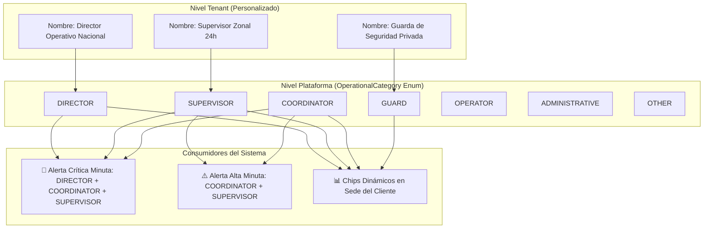
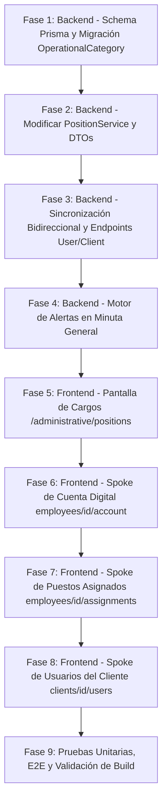

# SPEC-REG-016: Homologación Integral de Fuerza Laboral: Categorías Operativas de Cargos, Gestión de Roles Digitales y Asignación Bidireccional de Sedes

> **Estado**: `COMPLETADO`  
> **Módulo**: `regulation` / `administrative` / `operation`  
> **Ubicación Frontend**:  
> - `src/app/(protected)/administrative/employees/[id]/account/page.tsx`  
> - `src/app/(protected)/administrative/employees/[id]/assignments/page.tsx`  
> - `src/app/(protected)/administrative/clients/[id]/users/page.tsx`  
> - `src/app/(protected)/administrative/positions/`  
> **Ubicación Backend**:  
> - `prisma/schema/position.prisma`  
> - `src/modules/regulation/position/`  
> - `src/modules/regulation/employee/`  
> - `src/modules/regulation/user/`  
> - `src/modules/administrative/client/`  
> - `src/modules/operation/minuta/services/minuta-general.service.ts`  
> **Fecha de Creación**: 2026-10-19  
> **Autor**: Antigravity (Software Architect & Pair Programming)  

---

## 1. Contexto de Negocio y Diagnóstico de Problemas

Durante las pruebas operativas de la Ficha Integral del Empleado y del Equipo Asignado al Cliente, se detectaron discrepancias funcionales, falta de estandarización visual y un reto estructural en la determinación de cargos para las alertas operativas:

### 1.1 Inconsistencias en Cuenta Digital del Empleado (`employees/[id]/account`)
1. **Imposibilidad de Modificar Roles**: La tarjeta "Perfiles y Roles" muestra los roles en chips de sólo lectura sin un disparador de edición para asignar o remover roles del usuario.
2. **Imposibilidad de Deshabilitar el Acceso Digital**: La tarjeta muestra el badge "Usuario Activo" pero carece de un botón de acción para suspender/reactivar las credenciales de acceso digital sin afectar el contrato del empleado.

### 1.2 Inconsistencias en Puestos Asignados (`employees/[id]/assignments`)
1. **Historial Cronológico Vacío**: La sección de historial mostraba "0 registros / No registra historial" a pesar de haber sedes activas vinculadas, debido a una discrepancia de serialización (`history` retornado en el backend vs `clientHistory` esperado en el frontend) y falta de inserción histórica al asignar desde clientes.
2. **Asignación sin Fechas ni Trazabilidad**: El botón `+ Asignar a este Puesto` asignaba inmediatamente a ciegas con la fecha de hoy, sin solicitar fechas de vigencia ni observaciones.
3. **Nomenclatura Inadecuada**: El botón "Finalizar Relevo" debe ajustarse a **"Desvincular Cliente"**, y el drawer correspondiente debe alinearse a este propósito.
4. **Falta de Navegación Rápida**: Al hacer clic sobre la tarjeta de un cliente activo, la plataforma no redirigía a la ficha de dicho cliente.

### 1.3 Inconsistencias en Equipo Asignado al Cliente (`clients/[id]/users`)
1. **Buscador de Usuarios No Estandarizado**: Los resultados del buscador de usuarios se renderizaban centrados y sin los badges/chips distintivos que sí tiene el estándar institucional (`EmployeeAutocomplete`).
2. **Dropdown Manual de Función/Cargo Redundante**: El modal contenía un dropdown de texto libre/predefinido (`COORDINADOR`, `SUPERVISOR`, etc.) donde el operador inventaba la función en lugar de heredar el Cargo oficial del empleado.
3. **Chips de Conteo Estáticos en Cabecera**: Los chips superiores (`Coordinadores: 0`, `Supervisores: 0`, `Operativos: 0`) eran fijos e independientes de los cargos reales de la empresa.

### 1.4 El Desafío de las Alertas en la Minuta General
* Actualmente, el despacho de notificaciones para **Alertas Altas** (Prioridad 4) y **Alertas Críticas** (Prioridad 5) en la minuta general realizaba búsquedas de texto parcial con `contains: 'Supervisor'` y `contains: 'Director'` en el campo `position` del usuario.
* Dado que cada empresa de seguridad (tenant) nombra sus cargos de forma diferente (*"Coordinador de Seguridad Física"*, *"Supervisor Zonal Móvil"*, *"Director Operativo"*), la coincidencia por texto libre genera:
  * **Falsos positivos**: Un *"Asistente de Dirección"* recibiría alertas confidenciales.
  * **Falsos negativos**: Un *"Jefe de Operaciones"* o *"Líder de Zona"* no recibiría la alerta crítica, vulnerando la seguridad de la copropiedad.

---

## 2. Decisión Arquitectónica: Categoría Operativa (`OperationalCategory`)

Para conciliar la libertad comercial de cada empresa de seguridad con la exactitud técnica absoluta que exige el despacho de alertas, se adopta la **Opción 3: Categoría o Jerarquía Operativa en el Cargo**.

### 2.1 Principio Rector
* **Nombre del Cargo (`Position.name`)**: Texto comercial y contractual libre definido por el tenant (ej. *"Líder de Cuadrante Zona Norte"*, *"Coordinador de Operaciones y Medios"*).
* **Categoría Operativa (`Position.operationalCategory`)**: Clasificador estándar del sistema (`enum`) que gobierna la lógica de alertas, turnos y agrupaciones.



### 2.2 Extensión del Schema Prisma (`position.prisma`)

```prisma
enum OperationalCategory {
  DIRECTOR        // Directores, Gerentes de Operaciones, Jefes de Seguridad
  COORDINATOR     // Coordinadores de cuenta, zonales, de servicio
  SUPERVISOR      // Supervisores de puesto, patrulleros, recorredores
  GUARD           // Guardas de seguridad, vigilantes, vigilantes caninos
  OPERATOR        // Operadores de CCTV, medios tecnológicos, consolas
  ADMINISTRATIVE  // Personal administrativo, comercial, talento humano
  OTHER           // Otros cargos no catalogados
}

model Position {
  id                  String              @id @default(cuid(2))
  tenantId            String
  name                String
  level               Int?
  operationalCategory OperationalCategory @default(GUARD)
  isActive            Boolean             @default(true)

  tenant              Tenant              @relation(fields: [tenantId], references: [id], onDelete: Cascade)
  employees           Employee[]          @relation("EmployeePosition")

  createdAt           DateTime            @default(now())
  updatedAt           DateTime            @default(now())
  createdBy           String?
  updatedBy           String?

  @@unique([tenantId, name])
  @@index([tenantId])
  @@index([operationalCategory])
  @@map("position")
}
```

### 2.3 Migración Inteligente Retrocompatible
Se implementará una migración automática que clasifique todos los cargos preexistentes en los tenants mediante reglas semánticas seguras:
* `name` contiene `"direct"` o `"geren"` $\rightarrow$ `DIRECTOR`
* `name` contiene `"coord"` $\rightarrow$ `COORDINATOR`
* `name` contiene `"superv"` $\rightarrow$ `SUPERVISOR`
* `name` contiene `"cctv"` o `"medio"` o `"operad"` o `"consola"` $\rightarrow$ `OPERATOR`
* `name` contiene `"admin"` o `"comercial"` o `"rrhh"` o `"talento"` $\rightarrow$ `ADMINISTRATIVE`
* Otros casos $\rightarrow$ `GUARD`

---

## 3. Especificación Técnica por Componente

---

### Módulo 1: Cuenta Digital del Empleado (`employees/[id]/account`)

1. **Modificación de Roles Digitales**:
   * En la tarjeta "Perfiles y Roles", agregar botón **"Modificar Roles"** con ícono de permisos.
   * Abre un **Side Drawer** (`420px`) con la lista completa de roles del tenant (`GET /roles`).
   * Permite alternar selecciones y ejecutar `PATCH /users/:userId/roles` enviando `{ addRoleIds, removeRoleIds }`.
   * Refresca inmediatamente el contexto `EmployeeDetailContext`.
2. **Habilitar / Deshabilitar Usuario**:
   * En la tarjeta "Datos de Acceso Digital", incorporar botón conmutador:
     * Si `user.isActive === true`: botón **"Deshabilitar Cuenta"** (color warning/error).
     * Si `user.isActive === false`: botón **"Habilitar Cuenta"** (color success).
   * Backend: Crear endpoint `PATCH /user/:userId/status` con body `{ isActive: boolean }` que actualiza el flag y revoca sesiones en caso de desactivación.

---

### Módulo 2: Puestos Asignados (`employees/[id]/assignments`)

1. **Corrección de Clave y Serialización en Backend**:
   * En [`EmployeeService.getWorkforceSummary`](file:///d:/projects/security-crm-backend/src/modules/regulation/employee/employee.service.ts), unificar el objeto retornado:
     ```typescript
     return {
       employee: employeeDto,
       user: userData,
       activeAssignments: Array.from(activeAssignmentsMap.values()),
       clientHistory: rawHistory, // Clave corregida
     };
     ```
2. **Sincronización Bidireccional de Asignaciones**:
   * Cuando se asigne o desvincule a un usuario desde el módulo de Clientes (`ClientService.assignUser` / `unassignUser`), si el usuario tiene un registro `Employee` vinculado, se agregará automáticamente la entrada a `employee.clientHistory` y se actualizará `employee.clientId`.
3. **Drawer de Asignación de Puestos**:
   * Al hacer clic en `+ Asignar a este Puesto` en el Command Box inferior, se abre un Drawer que captura:
     * Fecha de inicio en el puesto (`assignedAt`, por defecto fecha actual).
     * Checkbox de asignación concurrente (permite mantener otros puestos activos).
     * Si no es concurrente, fecha de cierre del puesto anterior (`unassignedAt`).
     * Observaciones operativas del relevo.
4. **Renombrar a "Desvincular Cliente" y Estandarizar Drawer**:
   * El botón en la tarjeta de puesto activo se renombra a **"Desvincular Cliente"**.
   * Abre el Drawer **"Desvincular Cliente de la Cobertura"**, solicitando:
     * Fecha de desvinculación (`unassignedAt`).
     * Motivo (`reason`: Relevo de puesto, fin de contrato, rotación de cuadrante, etc.).
     * Observaciones de entrega.
5. **Navegabilidad Interactiva**:
   * Al hacer clic sobre cualquier punto de la tarjeta del cliente asignado, navega a `/administrative/clients/[clientId]/overview`.
   * El botón de desvinculación mantiene `event.stopPropagation()`.

---

### Módulo 3: Equipo Asignado en el Cliente (`clients/[id]/users`)

1. **Buscador Estandarizado de Usuarios**:
   * Sustituir el renderizado actual por el formato estándar de `EmployeeAutocomplete`:
     * Avatar con foto o iniciales.
     * Nombre completo y tipo/número de documento (`C.C. 1001001013`).
     * Chip destacado con su **Cargo oficial** (`Position.name`).
2. **Eliminación del Dropdown Manual de Cargo**:
   * Se elimina por completo el campo `PRESET_ROLES`.
   * Al seleccionar al usuario, se muestra una tarjeta informativa de sólo lectura:
     * **Cargo Oficial Heredado**: `[Position.name]` (`[OperationalCategory]`).
   * El backend toma automáticamente el cargo oficial y lo guarda en `UserClientAccess.roleName`.
3. **Chips Dinámicos en la Cabecera**:
   * En lugar de conteos estáticos, se calcula dinámicamente el resumen por categoría o cargo presente en la sede:
     * `Total: N`
     * `Directores: X`
     * `Coordinadores: Y`
     * `Supervisores: Z`
     * `Guardas: W`

---

### Módulo 4: Despacho de Alertas en Minuta General (`minuta-general.service.ts`)

1. **Consulta Determinista por Categoría Operativa**:
   * Reemplazar la búsqueda por texto libre por el filtro sobre `Position.operationalCategory`:
     ```typescript
     const targetCategories: OperationalCategory[] = [
       OperationalCategory.COORDINATOR,
       OperationalCategory.SUPERVISOR,
     ];

     if (priority === 5) {
       targetCategories.push(OperationalCategory.DIRECTOR);
     }

     const assignedTeam = await this.prisma.userClientAccess.findMany({
       where: {
         clientId,
         isActive: true,
         tenantId,
       },
       include: {
         user: true,
       },
     });

     // Obtener documentos de los usuarios asignados
     const docs = assignedTeam.map(t => t.user.document);

     // Buscar empleados cuyo cargo pertenezca a las categorías objetivo
     const eligibleEmployees = await this.prisma.employee.findMany({
       where: {
         tenantId,
         document: { in: docs },
         isActive: true,
         positionRef: {
           operationalCategory: { in: targetCategories },
         },
       },
       select: { document: true },
     });
     ```
   * Cero errores por diferencias ortográficas o variaciones en el nombre del cargo.

---

## 4. Plan Paso a Paso de Implementación



### Detalle de Fases:

#### Fase 1: Schema Prisma y Migración (`security-crm-backend`)
1. Modificar `prisma/schema/position.prisma` agregando `enum OperationalCategory` y el campo `operationalCategory` en `Position`.
2. Crear migración SQL con script de auto-clasificación para datos existentes.
3. Ejecutar `npx prisma migrate dev` y `npx prisma generate`.

#### Fase 2: Módulo de Cargos (`PositionModule`)
1. Actualizar `CreatePositionDto`, `UpdatePositionDto` y `PositionResponseDto` para incluir `operationalCategory`.
2. Actualizar `PositionService` y `position.repository.service.ts` para persistir la categoría.

#### Fase 3: Endpoints de Usuarios y Sincronización Bidireccional
1. Agregar endpoint `PATCH /user/:userId/status` con `{ isActive: boolean }` en `UserController` y `UserService`.
2. Modificar `ClientService.assignUser` y `unassignUser` para sincronizar `employee.clientHistory` si el usuario es un empleado.
3. Corregir `EmployeeService.getWorkforceSummary` retornando la propiedad `clientHistory`.

#### Fase 4: Motor de Alertas de Minuta General
1. Actualizar `MinutaGeneralService.createMinuta` para filtrar destinatarios por `Position.operationalCategory` (`DIRECTOR`, `COORDINATOR`, `SUPERVISOR`).
2. Actualizar pruebas unitarias en `minuta-general.service.spec.ts`.

#### Fase 5: Frontend - Configuración de Cargos
1. Modificar formulario de creación y edición en `/administrative/positions` agregando el selector de `Categoría Operativa` con chips descriptivos.

#### Fase 6: Frontend - Cuenta Digital del Empleado
1. Agregar botón y Drawer para **"Modificar Roles"** conectado a `PATCH /users/:userId/roles`.
2. Agregar botón de confirmación para **"Habilitar / Deshabilitar Cuenta Digital"** conectado a `PATCH /user/:userId/status`.

#### Fase 7: Frontend - Puestos Asignados del Empleado
1. Reparar el timeline del historial cronológico vinculando `summary.clientHistory`.
2. Renombrar botón a **"Desvincular Cliente"** y ajustar Drawer con captura de fecha y motivo.
3. Al hacer clic en la tarjeta de cliente activo, redirigir a `/administrative/clients/[id]/overview`.
4. En el Command Box, abrir Drawer de asignación con captura de fecha inicial y concurrencia.

#### Fase 8: Frontend - Equipo Asignado al Cliente
1. Estandarizar el buscador de usuarios con avatar, nombre, documento y chip del Cargo oficial.
2. Eliminar el dropdown manual de función; mostrar tarjeta informativa de cargo heredado.
3. Implementar chips de conteo dinámicos agrupados por cargo en la cabecera.

#### Fase 9: Validación de Calidad y Cierre
1. Ejecutar pruebas unitarias de backend: `npm run test` (verificando cobertura $\ge 80\%$).
2. Ejecutar chequeo de tipos en frontend: `npx tsc --noEmit`.
3. Ejecutar compilación de producción: `npm run build`.

---

## 5. Criterios de Aceptación

| ID | Criterio de Aceptación | Método de Verificación |
| :--- | :--- | :--- |
| **CA-01** | Todo cargo tiene una `OperationalCategory` asignada y los cargos existentes se auto-clasifican sin pérdida de datos. | Consulta a BD y verificación en formulario de cargos. |
| **CA-02** | Alerta Alta notifica con precisión a Coordinadores y Supervisores de la sede; Alerta Crítica suma a Directores. | Prueba unitaria y ejecución de dispatch en MinutaGeneralService. |
| **CA-03** | El operador puede cambiar los roles de un usuario digital desde la ficha del empleado mediante un Drawer. | Interacción en `/administrative/employees/[id]/account`. |
| **CA-04** | El operador puede habilitar y deshabilitar la cuenta digital con confirmación visual de estado. | Toggle de estado y validación de `isActive` en BD. |
| **CA-05** | El historial cronológico de puestos asignados muestra todos los registros históricos ordenados por fecha. | Verificación visual en `/administrative/employees/[id]/assignments`. |
| **CA-06** | Al hacer clic en el cuadro de un cliente asignado, el sistema redirige a `/administrative/clients/[id]/overview`. | Clic sobre tarjeta y verificación de URL. |
| **CA-07** | Al asignar un usuario a un cliente, el buscador muestra chips estandarizados y hereda su cargo sin dropdowns manuales. | Interacción en `/administrative/clients/[id]/users`. |
| **CA-08** | Los chips en la cabecera de equipo asignado al cliente se agrupan y calculan dinámicamente. | Validación visual según el equipo vinculado a la sede. |
