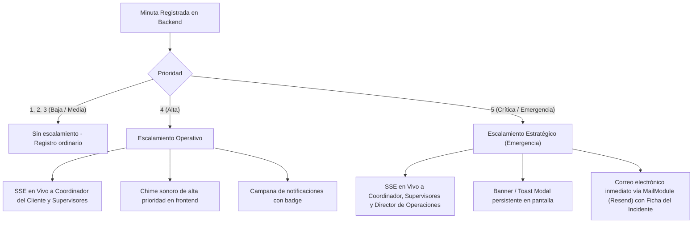

# SPEC-OPE-010: Minuta General Multimedia, Exportación PDF, Escalamiento de Alertas, Audio Probatorio y Ciclos de Vida Operativos

> **Estado**: `COMPLETADO`  
> **Módulo**: `operation` (Minuta General, Correspondencia, Visitantes, Parqueadero)  
> **Ubicación Frontend**: `src/app/(protected)/operation/minuta-general/`, `src/app/(protected)/operation/correspondence/`, `src/lib/pdf/`  
> **Ubicación Backend**: `src/modules/operation/minuta/`, `src/modules/storage/`, `src/modules/notifications/`, `prisma/seed.ts`  
> **Fecha de Creación**: 2026-10-16  
> **Autor**: Antigravity (Software Architect)  

---

## 1. Contexto de Negocio y Problemática Identificada

### 1.1 Problemática Operativa y Evidencial en Novedades Críticas
1. **Límite de Evidencia en Incidentes Graves**:
   - Actualmente, la minuta general solo permite adjuntar **una única fotografía** (`evidenceFile: File | null`), independientemente de si la anotación es un parte de rutina o una novedad crítica (ej. conflagración, hurto, intrusión perimetral, riña). 
   - Una sola toma es insuficiente para fijar la escena de los hechos, el estado de los accesos o los elementos vulnerados. Se requiere capacidad de adjuntar múltiples fotografías y un video clip corto testimonial de hasta 30 segundos.
2. **Ausencia de Registro Auditivo de la Novedad**:
   - En momentos de alta adrenalina, el personal de seguridad puede cometer errores mecanográficos o retrasar el reporte mientras escribe. La transcripción por voz agiliza el reporte, pero además es crítico conservar el **archivo de audio real original** para escuchar el tono del guarda, la respiración, el ruido ambiente (sirenas, disparos, radios) y garantizar la cadena de custodia probatoria.
3. **Falta de Exportación Formal en PDF**:
   - Para entregar reportes a la administración del conjunto residencial, aseguradoras o a la Policía Nacional, los usuarios autorizados necesitan descargar el libro de minutas por rango de fechas o la ficha pericial de un incidente puntual en PDF membretado con la identidad corporativa de la empresa de seguridad.
4. **Desconexión en el Escalamiento Inmediato**:
   - Al registrarse una novedad de prioridad Alta (4) o Crítica (5), la información permanece pasiva en la tabla hasta que un supervisor ingresa a consultar. Se requiere escalamiento proactivo multicanal (SSE en tiempo real + sonido distintivo + correo electrónico formal al Director de Operaciones y Coordinador).
5. **Bloqueo 403 Forbidden en Entregas y Salidas (Conflicto de Permisología)**:
   - Para salvaguardar la inmutabilidad de la minuta, a los vigilantes se les asigna únicamente `minuta:create` y `minuta:read` (sin `minuta:update`).
   - Sin embargo, los endpoints de entrega de correspondencia (`PATCH /operation/minuta/correspondence/:id/deliver`), salida de visitantes (`PATCH /operation/minuta/visitor/:id/exit`) y salida de vehículos (`PATCH /operation/minuta/parking/:id/exit`) exigen estrictamente `minuta:update`.
   - Como resultado, el guardia registra el ingreso del paquete o visitante, pero cuando va a entregarlo o registrar la salida, el sistema le bloquea la acción con un Error 403 Forbidden.

---

## 2. Decisiones Arquitectónicas

### 2.1 Punto 1: Evidencia Multimedia Extendida (Fotos Múltiples y Video 30s)

#### A. Modelo de Datos Existente
El modelo Prisma [`MediaAttachment`](file:///d:/projects/security-crm-backend/prisma/schema/media_attachment.prisma) ya implementa la relación `1:N` con `Minuta` (`minutaId String?`). **No requiere modificaciones en la base de datos**.

#### B. Comportamiento Dinámico por Nivel de Prioridad en Frontend
- **Prioridad 1, 2 y 3 (Muy Baja, Baja, Media)**:
  - Formulario estándar: hasta **2 fotografías**.
  - Enfoque: registros ordinarios de rutina y relevo de turno.
- **Prioridad 4 y 5 (Alta y Crítica)**:
  - **Galería de hasta 5 fotografías**.
  - **Módulo de Video Clip Corto (hasta 30 segundos)**:
    - Grabación en vivo mediante `navigator.mediaDevices.getUserMedia({ video: true, audio: true })` y `MediaRecorder API`.
    - Temporizador visual regresivo que corta automáticamente el stream al llegar a los 30 segundos.
    - Soporte de subida alternativa de archivo `.mp4` o `.webm`.
    - Previsualización local inmediata con opción de descartar o regrabar.

#### C. Ajuste de Capacidad en Backend NestJS
En [storage.controller.ts](file:///d:/projects/security-crm-backend/src/modules/storage/controllers/storage.controller.ts#L62), se incrementa el `MaxFileSizeValidator`:
```typescript
new MaxFileSizeValidator({ maxSize: 35 * 1024 * 1024 }) // Elevado de 15MB a 35MB
```
Esto admite cómodamente video comprimido en 720p/1080p (que en 30s ronda entre 10 MB y 22 MB) y fotos de alta resolución.

---

### 2.2 Punto 2: Exportación a Formato PDF (`jspdf` + `jspdf-autotable`)

#### A. Identidad Corporativa desde `Tenant` y `TenantProfile`
El generador PDF consumirá el contexto de la empresa autenticada:
- Logo: `tenant.logoUrl` (si existe, se convierte a Base64 y se coloca en el encabezado superior izquierdo; si no existe, se genera un membrete tipográfico institucional).
- Encabezado: `tenant.profile.legalName`, `tenant.profile.taxId` (NIT/RUT), Dirección y Teléfono de contacto.
- Colores de marca: Uso de `tenant.primaryColor` para cintillos, cabeceras de tabla y distintivos de severidad.

#### B. Los Dos Modos de Exportación

1. **Reporte Consolidado por Rango de Fechas (Libro de Minutas Digital)**:
   - **Acceso**: Botón `"Exportar PDF"` en el toolbar superior de la tabla de minutas.
   - **Filtros del Diálogo**: Rango de fechas (`startDate`, `endDate`), Cliente / Conjunto específico (para usuarios globales) y filtro opcional por severidad.
   - **Estructura del Documento**:
     - Membrete y datos del cliente/sede auditada.
     - Métricas KPI (Total registros, Novedades ordinarias, Altas, Críticas).
     - Tabla estilizada con `jspdf-autotable`: Fecha, Hora, Severidad, Puesto, Vigilante de Turno, Resumen de Anotación.
     - Paginación automática: *"Página X de Y"* y pie de firma institucional.

2. **Ficha Pericial de Incidente / Registro Individual**:
   - **Acceso**:
     - Opción en el menú kebab de cada fila: `"Exportar Ficha PDF"`.
     - Botón de acción primario dentro del Drawer de detalle: `"Descargar PDF"`.
   - **Estructura del Documento (1 o 2 páginas)**:
     - Encabezado formal con Radicado / CUID único.
     - Banner cromático de severidad (Rojo para Crítica, Naranja para Alta, Azul para Media/Baja).
     - Ficha de servicio: Conjunto, Puesto, Guarda que reporta, Fecha y Hora exacta del evento.
     - Texto completo de la anotación.
     - **Galería de Evidencias Integradas**: Renderizado de las fotografías adjuntas directamente dentro del PDF con su respectiva estampa de tiempo.
     - Sección legal de firmas: Firma del Guarda emisor y Firma del Supervisor / Coordinador receptor.

#### C. Permisología Granular
Se crea el permiso en el catálogo ([prisma/seed.ts](file:///d:/projects/security-crm-backend/prisma/seed.ts)):
```typescript
{
  name: 'minuta:export',
  description: 'Exportar reportes y fichas de minuta en formato PDF',
}
```
Asignado por defecto a los roles: `GODLIKE`, `ADMIN`, `DIRECTOR_OPERATIONS`, `COORDINATOR`, `SUPERVISOR`.

---

### 2.3 Punto 3: Escalamiento Multicanal de Alertas Operativas

#### A. Matriz de Severidad y Notificaciones



#### B. Lógica en `MinutaGeneralService`
Al crear o actualizar una minuta con `priority >= 4`:
1. Identifica el `clientId` de la minuta.
2. Resuelve los destinatarios del tenant:
   - Usuario Coordinador a cargo del cliente (`client.coordinatorInChargeId`).
   - Usuarios del tenant con rol `SUPERVISOR` asignados o activos.
   - Si `priority === 5`: Resuelve adicionalmente al `DIRECTOR_OPERATIONS` del tenant.
3. Despacha la notificación en base de datos y por SSE mediante `NotificationsService.createNotification(...)`.
4. Si `priority === 5`: Despacha un correo electrónico con plantilla HTML mediante `MailService.sendEmail(...)` con asunto:  
   `🚨 [ALERTA CRÍTICA] {clientName} - Novedad de Seguridad Radicado #{radicado}`.

---

### 2.4 Punto 4: Dictado por Voz (Web Speech API) + Respaldo de Audio Real Inmutable

#### A. Doble Captura Paralela en Cliente
Al pulsar el botón del micrófono en el formulario:
1. Se abre el stream `navigator.mediaDevices.getUserMedia({ audio: true })`.
2. **Proceso 1 (Transcripción)**: `webkitSpeechRecognition` en español (`es-CO` / `es-ES`) escribe el texto de forma continua y en tiempo real directamente en el campo `annotation`.
3. **Proceso 2 (Grabación Probatoria)**: `MediaRecorder` empaqueta los fragmentos de audio en un `Blob` (`audio/webm` o `audio/mp4`).
4. Al detener la grabación, el vigilante tiene el texto en pantalla para validar o editar y un reproductor de audio local para verificar lo grabado.

#### B. Almacenamiento y Visualización
- Al enviar el formulario, el archivo de audio se sube a S3 con `subType: "voice_note"` y queda registrado como `MediaAttachment` asociado a la minuta.
- En la vista de detalle ("Ver Detalle"), se renderiza un componente de reproducción de audio:
  `<audio controls src={voiceNoteUrl} />`
  permitiendo a supervisores y directores escuchar la entonación, nivel de alerta y ruidos de fondo de la garita/puesto.

---

### 2.5 Punto 5: Desbloqueo de Ciclos de Vida Operativos (Permisología)

#### A. Causa Raíz
Los vigilantes deben tener `minuta:create` y `minuta:read`, pero **no** `minuta:update`, para proteger la inmutabilidad histórica. Sin embargo, marcar una entrega de correspondencia o una salida de visitante/vehículo es el **cierre del ciclo operativo**, no una edición del pasado.

#### B. Ajuste de Controladores
Se flexibilizan los decoradores de permisos en los endpoints de ciclo de vida:

1. **Correspondencia / Domicilios** ([correspondence-control.controller.ts](file:///d:/projects/security-crm-backend/src/modules/operation/minuta/controllers/correspondence-control.controller.ts#L77-L87)):
   ```typescript
   @Patch(':id/deliver')
   @RequirePermissions('minuta:manage', 'minuta:update', 'minuta:create')
   deliver(...)
   ```
2. **Control de Visitantes** ([visitor-control.controller.ts](file:///d:/projects/security-crm-backend/src/modules/operation/minuta/controllers/visitor-control.controller.ts#L77-L87)):
   ```typescript
   @Patch(':id/exit')
   @RequirePermissions('minuta:manage', 'minuta:update', 'minuta:create')
   registerExit(...)
   ```
3. **Control de Parqueadero** ([parking-control.controller.ts](file:///d:/projects/security-crm-backend/src/modules/operation/minuta/controllers/parking-control.controller.ts#L77-L87)):
   ```typescript
   @Patch(':id/exit')
   @RequirePermissions('minuta:manage', 'minuta:update', 'minuta:create')
   registerExit(...)
   ```

*Blindaje de Seguridad*:
- `PATCH /operation/minuta/*/:id` (modificar atributos históricos) **sigue requiriendo estrictamente `minuta:update` y `minuta:manage`**.
- `PATCH /operation/minuta/*/:id/void` (anular registros) **sigue requiriendo estrictamente `minuta:update` y `minuta:manage`**.

---

## 3. Plan de Pruebas Unitarias Exhaustivo

Se desarrollarán pruebas unitarias rigurosas en Jest para backend y React Testing Library / Vitest para frontend cubriendo cada funcionalidad:

### 3.1 Backend: Pruebas Unitarias de Minuta y Escalamiento
- **Archivo**: `src/modules/operation/minuta/services/minuta-general.service.spec.ts`
  1. *should create minuta with priority <= 3 without triggering escalation notifications*.
  2. *should trigger SSE notification to coordinator and supervisors when priority is 4 (Alta)*.
  3. *should trigger SSE notification and send critical email to Director of Operations, Coordinator and Supervisors when priority is 5 (Crítica)*.
  4. *should associate multiple media attachments (photos, video and voice note) to the minuta record*.
  5. *should gracefully handle mail service failure during priority 5 escalation without rolling back database transaction*.

### 3.2 Backend: Pruebas Unitarias de Permisos en Ciclos de Vida
- **Archivo**: `src/modules/operation/minuta/controllers/correspondence-control.controller.spec.ts`
  1. *should allow deliver package when user has minuta:create permission*.
  2. *should allow deliver package when user has minuta:update or minuta:manage*.
  3. *should reject deliver package when user only has minuta:read (403 Forbidden)*.
- **Archivo**: `src/modules/operation/minuta/controllers/visitor-control.controller.spec.ts`
  1. *should allow registerExit when user has minuta:create permission*.
  2. *should maintain strict minuta:update requirement on void and update endpoints*.
- **Archivo**: `src/modules/operation/minuta/controllers/parking-control.controller.spec.ts`
  1. *should allow vehicle registerExit when user has minuta:create permission*.

### 3.3 Backend: Validación de Tamaño de Archivo en Storage
- **Archivo**: `src/modules/storage/controllers/storage.controller.spec.ts`
  1. *should accept video files up to 35MB for MINUTA category*.
  2. *should reject media uploads exceeding 35MB with BadRequestException*.

### 3.4 Frontend: Pruebas Unitarias y de Integración de Utilidades
- **Archivo**: `src/lib/pdf/minuta-pdf-generator.spec.ts`
  1. *should generate consolidated PDF document with tenant branding and date range filtering*.
  2. *should generate single incident sheet PDF embedding attached photographs*.
  3. *should fallback to institutional text header when tenant.logoUrl is null*.
- **Archivo**: `src/components/operation/AudioVoiceNoteRecorder.spec.tsx`
  1. *should start audio recording and stream transcript into target input simultaneously*.
  2. *should produce audio/webm blob upon stop event*.

---

## 4. Plan de Implementación Paso a Paso

- [ ] **Paso 1 (Backend - Permisos y Catálogo de Roles)**:
  - Registrar permiso `minuta:export` en `prisma/seed.ts` y asignarlo a roles administrativos y de supervisión.
  - Ejecutar seed de actualización de catálogo de permisos.
- [ ] **Paso 2 (Backend - Endpoints de Ciclo de Vida y Almacenamiento)**:
  - Ajustar `@RequirePermissions('minuta:manage', 'minuta:update', 'minuta:create')` en `correspondence-control.controller.ts`, `visitor-control.controller.ts` y `parking-control.controller.ts`.
  - Incrementar `maxSize` a 35MB en `storage.controller.ts`.
- [ ] **Paso 3 (Backend - Lógica de Escalamiento de Alertas)**:
  - Inyectar `NotificationsService` y `MailService` en `MinutaGeneralService`.
  - Implementar método `handlePriorityEscalation(minuta, tenantId)` para alertas 4 (Alta) y 5 (Crítica).
  - Redactar plantilla de correo HTML para novedades críticas.
- [ ] **Paso 4 (Frontend - Utilidad Generadora de PDF)**:
  - Instalar dependencias `jspdf` y `jspdf-autotable`.
  - Crear módulo `src/lib/pdf/minutaPdfGenerator.ts` con funciones `generateMinutaRangePdf` y `generateMinutaSingleSheetPdf`.
  - Integrar logo del tenant y paleta de colores corporativa.
- [ ] **Paso 5 (Frontend - UI de Exportación en Minuta General)**:
  - Agregar botón "Exportar PDF" en toolbar con diálogo selector de rango de fechas.
  - Agregar acción "Descargar Ficha PDF" en menú kebab de la tabla y en el Drawer de detalle.
  - Proteger acciones visuales bajo el permiso `minuta:export`.
- [ ] **Paso 6 (Frontend - Grabación de Audio y Dictado Continuo)**:
  - Crear componente `AudioVoiceNoteRecorder.tsx` integrando `MediaRecorder API` y `webkitSpeechRecognition`.
  - Conectar el componente al formulario de creación de Minuta General.
  - Renderizar reproductor de audio `<audio controls>` en el Drawer de detalle cuando exista adjunto de voz.
- [ ] **Paso 7 (Frontend - Fotos Múltiples y Video Clip 30s)**:
  - Condicionar interfaz: si prioridad >= 4, permitir hasta 5 fotos y habilitar componente de video corto de 30s con temporizador regresivo.
  - Renderizar reproductor de video en el Drawer de detalle.
- [ ] **Paso 8 (Pruebas Unitarias & Control de Calidad)**:
  - Ejecutar suites de pruebas unitarias backend (`npm run test`).
  - Validar TypeScript en backend y frontend (`tsc --noEmit`).
  - Validar linter en ambos proyectos (`npm run lint`).
  - Validar build de producción en Next.js Turbopack (`npm run build`).

---

## 5. Criterios de Aceptación

1. **Ciclos de Vida Desbloqueados**: Un usuario con permiso `minuta:create` y `minuta:read` puede entregar paquetes de correspondencia y registrar la salida de visitantes y vehículos sin recibir error 403.
2. **Integridad de Modificación Preservada**: Un usuario sin `minuta:update` sigue teniendo estrictamente bloqueada la edición de campos históricos y la anulación de registros.
3. **Capacidad Multimedia**: Para alertas de prioridad 4 y 5, el sistema permite cargar hasta 5 fotos y un video clip de hasta 30 segundos, aceptando archivos de hasta 35 MB.
4. **Doble Captura de Voz y Audio**: El dictado por voz transcribe el texto directamente a la anotación y simultáneamente almacena el audio original en S3, reproduciéndose en el drawer de detalle.
5. **Exportación PDF Fiel y Membretada**: La exportación por rango de fechas genera un informe consolidado con logo, KPIs y tabla paginada. La exportación por registro genera una ficha de incidente pericial con fotos embebidas y campos de firma.
6. **Escalamiento Efectivo**: Al registrar una minuta con prioridad 4 se notifica en tiempo real por SSE con sonido al Coordinador y Supervisores; al registrar prioridad 5 se suma al Director de Operaciones y se envía correo electrónico inmediato.
7. **Cobertura de Pruebas**: 100% de las pruebas unitarias pasan exitosamente, cero errores de TypeScript y compilación de producción limpia.
