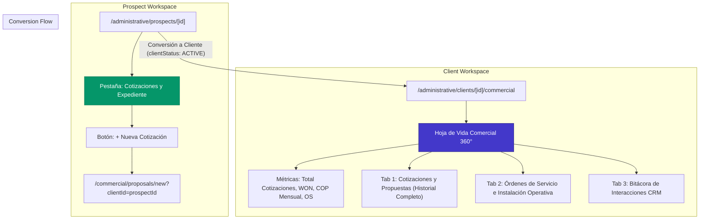

# SPEC-ADM-027: Expediente Comercial y Hoja de Vida 360° del Cliente (Historial de Cotizaciones, Propuestas y Órdenes de Servicio), Trazabilidad Prospecto-Cliente y Erradicación de Diálogo por Drawer

> **Estado**: `IMPLEMENTADO Y VALIDADO`  
> **Módulos Backend**: `modules/administrative/client`, `modules/administrative/prospect`, `modules/commercial/proposals`, `modules/commercial/service-orders`  
> **Módulos Frontend**: `administrative/clients/[id]/commercial`, `administrative/prospects/[id]`, `commercial/proposals`, `commercial/service-orders`  
> **Código de Especificación**: `SPEC-ADM-027-client-commercial-dossier-and-prospect-quotation-history`  
> **Fecha de Creación**: `2026-10-28`  
> **Fecha de Validación**: `2026-10-28`  
> **Autor(es)**: `Antigravity Core Engineering`  

---

## 1. Contexto de Negocio y Necesidad Operativa

### 1.1 Hoja de Vida Comercial del Cliente (Expediente 360°)
En la operación de seguridad privada, cada cliente y prospecto atraviesa un ciclo vital de interacción comercial: prospección, recepción de requerimientos, emisión de múltiples versiones de cotizaciones y propuestas técnicas, negociación económica y adjudicación (WON), concluyendo en la emisión de Órdenes de Servicio (OS) con Código OMEGA estatutario y dotación operativa.

Actualmente, el módulo de Clientes (`/administrative/clients/[id]`) dispone de submódulos para Legal, Operaciones, Residentes y Estudios de Seguridad, pero carece de una **pestaña dedicada al Historial Comercial / Hoja de Vida**. Esto fragmentaba la trazabilidad del contrato, obligando a los directores y coordinadores a salir del expediente del cliente para buscar sus cotizaciones en la tabla general de propuestas.

### 1.2 Trazabilidad Ininterrumpida Prospecto $\rightarrow$ Cliente
En la base de datos de NOXIA, la tabla `client` aloja tanto prospectos (`clientStatus: PROSPECT`) como clientes activos (`clientStatus: ACTIVE`). Debido a que comparten la misma entidad relacional y la misma clave primaria `id`, **todas las cotizaciones (`CommercialProposal`), órdenes (`ServiceOrder`), bitácoras de seguimiento (`CommercialFollowUp`) y estudios de seguridad vinculados a un prospecto permanecen automáticamente asociados cuando este se convierte en cliente**.

Se requiere exponer esta trazabilidad en las interfaces:
1. En el perfil del prospecto (`/administrative/prospects/[id]`): Pestaña dedicada para consultar y emitir cotizaciones asociadas a este prospecto.
2. En el perfil del cliente (`/administrative/clients/[id]`): Pestaña especializada `commercial` ("Historial Comercial / Hoja de Vida") que consolide las cotizaciones heredadas de su fase de prospecto y las generadas como cliente activo, sus órdenes de servicio y su bitácora CRM.
3. En el Cotizador Canvas (`CanvasProposalWorkspace.tsx`): Detección automática del query param `?clientId=[id]` para precargar el cliente o prospecto destinatario de forma inmediata al hacer clic en `+ Nueva Cotización`.

### 1.3 Mandato Zero-Dialog y Estilización de Botones Tácticos
Conforme a la directriz universal de UI/UX de NOXIA CRM (`frontend-noxia-style-guide.md` y decisión arquitectónica `[102]`), está categóricamente prohibido el uso de modales flotantes `<Dialog>`. 
El modal de confirmación "Aprobar y Marcar Propuesta como Ganada (WON)" en `/commercial/proposals` debe reemplazarse por un **`ResponsiveFormDrawer`** (cajón lateral derecho de 540px en desktop y bottom-sheet gestual en mobile), con botones estilizados según el sistema visual de Noxia (gradientes esmeralda, micro-interacciones hover, iconos representativos y jerarquía visual nítida).

---

## 2. Arquitectura de Solución y Componentes

---

## 3. Plan de Verificación y Criterios de Aceptación

1. **Zero-Dialog en Aprobación WON**: El modal flotante es sustituido al 100% por un `ResponsiveFormDrawer` lateral con botones de diseño industrial de alto impacto visual.
2. **Historial Comercial en Cliente**: La ruta `/administrative/clients/[id]/commercial` despliega las cotizaciones y órdenes del cliente con visualización de montos COP, P&L y acciones rápidas.
3. **Pestaña de Cotizaciones en Prospecto**: `/administrative/prospects/[id]` incluye la pestaña de cotizaciones y permite emitir nuevas propuestas vinculadas.
4. **Pre-selección en Cotizador**: Al acceder a `/commercial/proposals/new?clientId=[id]`, el cliente o prospecto queda seleccionado automáticamente en el lienzo.
5. **Calidad de Código**: Backend al 100% de suites verdes (84/84), 0 errores TypeScript (`tsc --noEmit`) y 0 errores de ESLint.

