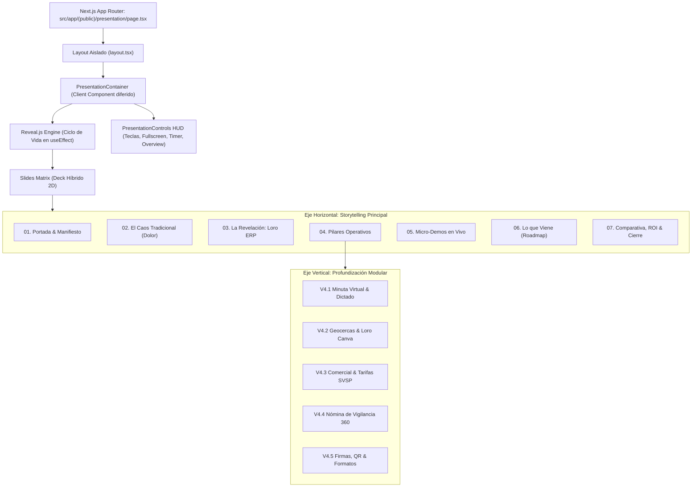

# SPEC-ADM-035: Presentación Interactiva Institucional y Comercial "Loro ERP" (Reveal.js + Next.js 16)

> **Estado**: `COMPLETADO`  
> **Módulo**: `administrative / commercial / public`  
> **Autor(es)**: Lead Software Architect, Senior Content Writer, Lead UI/UX Designer & Marketing Strategist  
> **Fecha de Creación**: 2026-11-04  
> **Última Actualización**: 2026-11-04  
> **Ámbito de Despliegue**: Frontend (`security-crm-frontend`) en Vercel  
> **Ruta Canónica Pública**: `src/app/(public)/presentation` (Acceso público sin credenciales)  

---

## 1. Contexto de Negocio e Historias de Usuario

### 1.1 Objetivo
Diseñar e implementar una **Presentación Interactiva de Alto Impacto ("Interactive Sales & Operations Pitch Deck")** alojada directamente dentro de la aplicación frontend de **Loro ERP** en una ruta pública accesible sin credenciales (`/presentation`).

El propósito central es dotar al equipo comercial, gerencial y técnico de un instrumento de **conversión y venta consultiva B2B** dirigido a dueños, directores generales y gerentes de operaciones de **empresas de vigilancia y seguridad privada**. La presentación debe transmitir con absoluta convicción que **Loro ERP no es un software genérico adaptado**, sino una plataforma de misión crítica concebida desde el puesto de guardia hasta la alta gerencia, ajustada quirúrgicamente a la legislación laboral colombiana (CST, Ley 2101), la normativa de la SuperVigilancia (tarifas mínimas, RENOVA, decretos de armas) y las fricciones operativas reales del sector.

La solución adopta una **arquitectura híbrida**:
- **Eje Horizontal (Pitch Ejecutivo ~12-15 min)**: Narrativa ágil de alto nivel enfocada en el dolor del cliente, la propuesta de valor, los pilares de solución, micro-demos en vivo, el roadmap y el ROI.
- **Eje Vertical (Profundización Técnica / Drill-Down)**: Diapositivas anidadas hacia abajo en Reveal.js para profundizar en las entrañas de cada módulo cuando el prospecto o su equipo técnico soliciten detalles exhaustivos (ej. desglose de conceptos de nómina, algoritmos matemáticos de horas extras o geocercas Mapbox).

### 1.2 Historias de Usuario (User Stories)
- **US-01 (Comercial / Preventa)**: Como Director Comercial de Loro ERP, quiero proyectar una presentación interactiva moderna desde cualquier navegador (PC, Mac, iPad o proyector) sin requerir login para deslumbrar a clientes potenciales en reuniones presenciales o videollamadas.
- **US-02 (Prospecto / Gerente de Seguridad)**: Como Gerente General de una empresa de vigilancia, quiero interactuar con simulaciones reales (ej. tarifas oficiales SVSP y cálculo de margen G&P) dentro de la misma presentación para convencerme de que el sistema comprende mis números y mi negocio.
- **US-03 (Director de Operaciones / TI)**: Como Director de Operaciones del cliente, quiero que el presentador navegue hacia abajo en las diapositivas de cada módulo para auditar los flujos detallados (minutas, firmas digitales, novedades de nómina, códigos de rondas) sin perder el hilo de la reunión.
- **US-04 (Marketing & Prospección)**: Como equipo de marketing, quiero compartir un enlace directo (`https://app.loroerp.com/presentation`) por WhatsApp o correo corporativo, con previsualización enriquecida (OpenGraph / Twitter Card) y capacidad de exportación a PDF limpio (`?print-pdf`) para que sirva como dossier digital descargable.

---

## 2. Definición de Permisos y Matriz de Acceso

### 2.1 Política de Acceso Público
- **Ruta Pública**: `/presentation` residirá dentro del grupo de rutas `(public)` en Next.js App Router (`src/app/(public)/presentation`).
- **Autenticación**: **Sin credenciales requeridas**. Cualquier usuario con el enlace puede acceder y navegar la presentación.
- **Seguridad y Aislamiento**:
  - No expone datos sensibles ni credenciales de tenants reales.
  - Las micro-demos interactivas utilizan datos simulados en memoria (mocked enterprise data) o llamadas a endpoints públicos de simulación sin alterar la base de datos de producción.
  - La ruta no carga ni ejecuta `JwtAuthGuard` ni consume el contexto de sesión privada.

---

## 3. Arquitectura Técnica de la Solución (Reveal.js en Next.js 16 + React 19)

### 3.1 Estructura de Componentes y Desacoplamiento



### 3.2 Aislamiento Estricto de Estilos (Anti-CSS Bleed)
Reveal.js inyecta clases globales en `body` y `html` (`.reveal-viewport`, `.reveal-full-page`). Para prevenir cualquier interferencia con el diseño del ERP:
1. La ruta `/presentation` cuenta con su propio `layout.tsx` que no renderiza la barra de navegación del ERP (`Navbar`, `DualRailNavigation`).
2. Los estilos de Reveal.js (`reveal.js/dist/reveal.css`) y el tema personalizado se cargan dinámicamente mediante módulos CSS o componentes con alcance local (`presentation.module.css`), aplicando prefijos específicos.
3. Al desmontar el componente (`unmount`), el orquestador invoca `deck.destroy()` y remueve las clases residuales del elemento `<html>` y `<body>`.

### 3.3 Soporte de React 19 y Next.js 16 (Turbopack)
- El deck se inicializa en el hook `useEffect` con importación asíncrona dinámica:
  ```typescript
  const Reveal = (await import('reveal.js')).default;
  const RevealHighlight = (await import('reveal.js/plugin/highlight/highlight')).default;
  const RevealNotes = (await import('reveal.js/plugin/notes/notes')).default;
  ```
- Opciones de configuración calibradas:
  - `hash: true` (permite compartir enlaces a diapositivas específicas, ej. `/presentation#/3/2`).
  - `controls: false` (sustituidos por nuestro HUD táctico flotante personalizado).
  - `progress: true` (barra de avance en el color primario `#7C3AED`).
  - `slideNumber: 'c/t'` (contador compacto de diapositivas).
  - `transition: 'slide'` y `backgroundTransition: 'fade'`.
  - `overview: true` (cuadrícula de pájaro al presionar `Esc`).

---

## 4. Matriz de Diapositivas y Narrativa de Conversión (Storyboard Maestro)

### Eje Horizontal (10 Diapositivas Maestras) + Eje Vertical (Profundizaciones)

| Posición | Título Diapositiva | Propósito Estratégico | Elementos Visuales / Interacción |
| :--- | :--- | :--- | :--- |
| **0.0** | **Portada: Loro ERP 2026** | Impacto inmediato de marca, autoridad y modernidad táctica. | Tipografía militar/tecnológica, badge "Hecho exclusivamente para empresas de seguridad", partículas sutiles. |
| **1.0** | **El Dolor Silencioso del Sector** | Generar empatía: identificar las 4 heridas que desangran a las empresas de vigilancia hoy. | Tarjetas comparativas: Bitácoras de papel rotas, Excel de 19MB inmanejables, multas SVSP, demandas laborales. |
| **2.0** | **El Nacimiento y la Evolución** | Transmitir autenticidad: de minuta virtual a ERP integral de misión crítica. | Línea de tiempo visual: 2024 Minuta -> 2025 CRM Operativo -> 2026 ERP Especializado. |
| **3.0** | **Arquitectura de Misión Crítica** | Demostrar que el software resiste auditorías y no se cae. | Diagrama infográfico: Multi-tenant impenetrable, ALS, trazabilidad inmutable forense. |
| **4.0** | **El Núcleo Operativo (Minutas 360°)** | Vender control en tiempo real en porterías y puestos de guardia. | Fotos reales S3, dictado por voz continuo, alertas multicanal (SSE/email) por severidad. |
| ↓ *4.1* | *Detalle: Correspondencia y Visitantes* | Demostrar cómo se eliminan paquetes perdidos y accesos no autorizados. | Flujo de entrega con foto/firma y autorización directa con unidad residencial. |
| ↓ *4.2* | *Detalle: Loro Canva y Mapbox CAD* | Deslumbrar al cliente con tecnología satelital de seguridad. | Perímetro georreferenciado, marcación de cámaras PTZ, barreras y zonas oscuras. |
| **5.0** | **Dirección Comercial & Tarifas SVSP** | Convencer de que Loro blinda la rentabilidad del contrato. | Cotizador dinámico, multiplicadores 8.8 vs 9.77 SMMLV, semáforo de margen G&P en vivo, Código OMEGA. |
| ↓ *5.1* | *Micro-Demo: Simulador Tarifario en Vivo* | **Interacción en vivo**: El cliente manipula SMMLV, factor A&S y turnos, viendo el precio exacto en tiempo real. | Componente interactivo React dentro del slide. |
| **6.0** | **Nómina Especializada de Vigilancia** | Resolver la mayor pesadilla administrativa: la liquidación 24/7. | Calendario 360, 8 tarifas horarias SVSP, incapacidades CIE-10, préstamos, dispersión ACH. |
| ↓ *6.1* | *Detalle: Cumplimiento RENOVA, PILA y DIAN* | Tranquilidad jurídica: cero multas ante entidades de control. | Exportador oficial RENOVA en Excel, Anexo Técnico DIAN UBL 2.1, Formulario 220. |
| **7.0** | **Herramientas de Soberanía (Firmas, QR & Formatos)** | Mostrar que la empresa no depende de software externo de terceros. | Loro Sign (firmas Ley 527), generador masivo de Códigos QR/Barras y estudio de formatos con pegado de Word/Excel. |
| ↓ *7.1* | *Micro-Demo: Generador de Código Táctico* | **Interacción en vivo**: Generar un código QR de ronda o código 128 de armamento en 1 clic. | Componente interactivo React dentro del slide. |
| **8.0** | **Lo que Viene: El Futuro Operativo** | Demostrar visión y compromiso a largo plazo (Roadmap). | Rondas GPS en vivo, login facial en garita, citofonía digital, algoritmo de "Guarda Ideal", E-learning. |
| **9.0** | **Retorno de Inversión (ROI) & Cierre** | Racionalizar la decisión económica y forzar el llamado a la acción. | Métricas gigantes: -85% tiempo en nómina, 0 paquetes extraviados, 100% blindaje legal. Botón de contacto directo. |

---

## 5. Diseño y Dirección de Arte: "Deep Violet Tactical Enterprise"

### 5.1 Paleta Cromática y Superficies
- **Fondo de Escenario**: `#09071A` (Midnight Void) y `#0F172A` (Slate Obsidian).
- **Acento Primario**: `#7C3AED` (Deep Violet) y `#8B5CF6` (Laser Violet).
- **Indicadores Semánticos**:
  - `#10B981` (Emerald Tech) -> Rentabilidad, conformidad legal, registro verificado.
  - `#F59E0B` (Amber Alert) -> Riesgo operativo, horas extras críticas, alerta de contrato.
  - `#EF4444` (Rose Threat) -> Caos tradicional, demandas laborales, sanciones de control.
- **Tipografía**:
  - *Plus Jakarta Sans*: Títulos con peso 800 (ExtraBold) y espaciado de tracking negativo sutil.
  - *JetBrains Mono*: Datos duros, valores monetarios en COP, códigos de tickets y métricas de seguridad.

### 5.2 Controles Flotantes del Presentador (HUD de Navegación)
Un panel flotante translúcido en la esquina inferior derecha con diseño HUD militar:
- `[◀]` `[▶]` Botones de avance táctil para tablets o presentaciones móviles.
- `[▲]` `[▼]` Indicador de diapositiva vertical (iluminado cuando hay contenido anidado).
- `[ ⛶ ]` Alternar Pantalla Completa (tecla `F`).
- `[ ▦ ]` Modo Vista General (tecla `Esc`).
- `[ ⏱ ]` Temporizador transcurrido de la reunión (útil para oradores).
- `[ 📄 ]` Botón de exportación rápida a PDF.

---

## 6. Micro-Demos Interactivas en Vivo

### 6.1 Demo 1: Simulador de Tarifas y Margen G&P (`LiveTariffDemo.tsx`)
Incrustado directamente en el slide de la Dirección Comercial:
- Sliders interactivos para:
  * Número de puestos de 24 horas.
  * Estrato socioeconómico (1-3 con 8.8 SMMLV vs 4-6 con 9.77 SMMLV).
  * Factor de Administración y Supervisión (8%, 10%, 11%).
- Resultados calculados reactivamente al instante:
  * Tarifa mensual facturada (COP).
  * Costo estimado de nómina por puesto.
  * Margen neto proyectado con semáforo comercial dinámico (🟢 >= 15%, 🟡 8-14.9%, 🔴 < 8%).

### 6.2 Demo 2: Generador de Códigos Tácticos (`LiveCodeGeneratorDemo.tsx`)
Incrustado en el slide de Herramientas de Soberanía:
- Selector de finalidad: "Punto de Ronda Nocturna", "Placa de Armamento (Revólver / Escopeta)", "Carnet de Guardia".
- Al presionar `Generar Identificador LORO`, genera en vivo el código criptográfico único y renderiza el código QR y código de barras Code-128 con botón de descarga.

---

## 7. Plan de Implementación de Archivos

```text
security-crm-frontend/
└── src/
    └── app/
        └── (public)/
            └── presentation/
                ├── page.tsx                           # Página principal con metadatos SEO / OpenGraph
                ├── layout.tsx                         # Layout aislado de la presentación
                ├── presentation.module.css            # Estilos del tema Deep Violet para Reveal.js
                └── components/
                    ├── PresentationDeck.tsx           # Orquestador del ciclo de vida de Reveal.js
                    ├── PresentationHud.tsx            # Controles flotantes ergonómicos y temporizador
                    ├── slides/                        # Diapositivas individuales modulares
                    │   ├── Slide00Hero.tsx            # Portada de alto impacto
                    │   ├── Slide01PainPoints.tsx      # El caos y costo del papel y Excel
                    │   ├── Slide02Evolution.tsx       # De minuta a ERP integral especializado
                    │   ├── Slide03Architecture.tsx    # Arquitectura de misión crítica y seguridad
                    │   ├── Slide04Operations.tsx      # Núcleo operativo y minutas 360°
                    │   ├── Slide04SubVisitors.tsx     # Detalle: Visitantes y paquetería
                    │   ├── Slide04SubCanva.tsx        # Detalle: Mapbox CAD y geocercas
                    │   ├── Slide05Commercial.tsx      # Dirección comercial, cotizador y órdenes OMEGA
                    │   ├── Slide05SubTariffDemo.tsx   # Micro-demo: Simulador interactivo en vivo
                    │   ├── Slide06Payroll.tsx         # Nómina especializada de vigilancia (CST, 24/7)
                    │   ├── Slide06SubCompliance.tsx   # Detalle: RENOVA, PILA y DIAN UBL 2.1
                    │   ├── Slide07Tools.tsx           # Herramientas de soberanía (Firmas, Códigos, Formatos)
                    │   ├── Slide07SubCodesDemo.tsx    # Micro-demo: Generador de códigos en vivo
                    │   ├── Slide08Roadmap.tsx         # Lo que viene: Rondas, biometría y E-learning
                    │   └── Slide09RoiAndCta.tsx       # Métricas de ROI, comparativa y llamado a la acción
                    └── widgets/                       # Micro-componentes tácticos compartidos
                        ├── TacticalStatCard.tsx       # Tarjeta de KPI con badge luminoso
                        ├── TacticalComparisonRow.tsx  # Fila comparativa Antes vs Ahora
                        └── LiveTariffWidget.tsx       # Widget reactivo del simulador
```

---

## 8. Criterios de Aceptación y Validación

- [x] **Acceso Público Directo**: La ruta `/presentation` carga instantáneamente sin solicitar credenciales ni redirigir a `/login`.
- [x] **Aislamiento Visual**: No se renderiza la barra de navegación del ERP, preservando la experiencia inmersiva de pantalla completa.
- [x] **Navegación 2D Fluida**:
  - Flechas `←` y `→` navegan por el arco ejecutivo horizontal.
  - Flechas `↓` y `↑` permiten entrar y salir de las diapositivas de profundización técnica.
  - Tecla `Espacio` avanza lógicamente por el flujo completo.
  - Tecla `Esc` abre la vista general de diapositivas (*Overview*).
  - Tecla `F` activa y desactiva pantalla completa.
  - Tecla `S` abre la ventana de notas del presentador con cronómetro.
- [x] **Micro-Demos Funcionales**: El usuario puede interactuar con el simulador de tarifas y el generador de códigos dentro de la diapositiva sin errores de React ni recarga de página.
- [x] **Compatibilidad Móvil / Táctil**: Desplazamiento por gestos táctiles (*swipe*) en teléfonos y tabletas con botones táctiles visibles en el HUD.
- [x] **Modo de Impresión / PDF**: Al agregar `?print-pdf` a la URL, las diapositivas se distribuyen en páginas A4 horizontales listas para imprimir a PDF en Chrome.
- [x] **Calidad de Código y Cero Regresiones**:
  - `npx.cmd tsc --noEmit` en frontend con 0 errores.
  - `npm.cmd run lint` en frontend con 0 errores.
  - `npm.cmd run build` genera las 53 rutas existentes más `/presentation` sin fallos en Turbopack (54 rutas en total).

