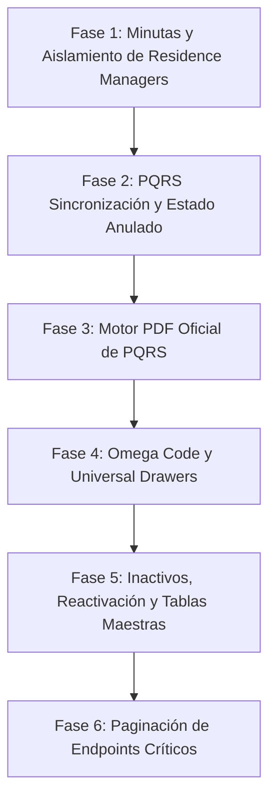

# SPEC-CORE-006: Integridad de Sistema, Ciclo de Vida e Inmutabilidad de PQRS, Aislamiento de Perfiles Residenciales, Generación Oficial de PDF y Estandarización Universal de Drawers y Tablas

> **Estado**: `COMPLETADO`  
> **Módulo**: `core-architecture / administrative / operation / regulation`  
> **Autor(es)**: `Software Architect & Senior Fullstack UX/UI Engineer`  
> **Fecha de Creación**: `2026-10-19`  
> **Última Actualización**: `2026-10-20`  

---

## 1. Contexto de Negocio e Historias de Usuario

El ecosistema **Noxia (Security CRM)** ha alcanzado un alto nivel de madurez técnica y operativa. Sin embargo, tras la revisión exhaustiva de los flujos de gestión operativa, PQRS, administración de identidad y experiencia de usuario (UI/UX), se han identificado brechas funcionales y oportunidades críticas de estandarización:

1. **Aislamiento de Perfiles de Usuario**: Los administradores de copropiedades y conjuntos residenciales (`UserType.RESIDENCE_MANAGER`) son contrapartes/clientes externos de la empresa de seguridad. Actualmente, consultas como `GET /user` o la asignación de personal a clientes y PQRS los exponen en selectores internos, cuando únicamente el personal operativo/administrativo de la empresa (`UserType.EMPLOYEE`) debe ser elegible.
2. **Ciclo de Vida, Inmutabilidad y Auditoría de PQRS**:
   - Una solicitud radicada posee valor probatorio y legal ante la **Superintendencia de Vigilancia y Seguridad Privada**. No debe ser modificable una vez emitida; el peticionario debe contar con la facultad de **Anularla (`VOIDED`)** con justificación obligatoria o aportar aclaraciones a través del hilo de mensajes.
   - Sincronización de estado: Al asignar un funcionario, el ticket debe reflejar de inmediato el estado `ASSIGNED`. Al cambiar manualmente el estado a `ASSIGNED`, el sistema debe exigir obligatoriamente la selección del funcionario asignado.
   - Exportación probatoria: Se requiere la generación de la **Ficha Oficial en PDF** de la PQRS (análoga a las minutas de seguridad) con membrete, radicado, detalle inalterable, trazabilidad cronológica de respuestas y firmas de conformidad.
3. **Ergonomía UI/UX ("Easy to track > Easy to read")**:
   - Limpieza en bitácoras operativas: Las 4 minutas (`general`, `parking`, `visitor`, `correspondence`) son registros históricos secuenciales; los botones de filtro "Todos - Activos - Inactivos" son redundantes y deben eliminarse.
   - Erradicación de modales invasivos restantes: Sustitución de diálogos modales flotantes por **Drawers laterales (desktop) / Bottom-sheets (mobile)** en:
     * Creación de residentes en el spoke del cliente.
     * Deshabilitación de cuenta digital de usuario con confirmación de documento.
     * Creación de nueva solicitud PQRS.
   - Claridad en clientes: Renombrar "Código Interno" a `"Omega (código interno)"` y exhibir su valor en la tarjeta de identidad del cliente en el menú lateral.
4. **Visibilidad de Inactivos, Reactivación y Personalidad Visual en Tablas Maestras**:
   - En las tablas de Usuarios, Departamentos, Cargos/Posiciones y Roles, los registros inhabilitados deben permanecer visibles cuando se filtren como "Todos" o "Inactivos", con la capacidad de ser rehabilitados directamente desde el menú kebab de acciones.
   - Homologación estética de las 4 tablas: Dotarlas de identidad visual, avatares temáticos, badges de estado semánticos con micro-acentos cromáticos y jerarquía tipográfica premium acorde al resto de la plataforma.
5. **Auditoría de Escalabilidad y Paginación en API**: Identificación e intervención de endpoints con riesgo de saturación por volumen de datos (`GET /employee`, `GET /resident/by-client/:clientId`, `GET /user`, `GET /prospect`).

---

### 1.1 Historias de Usuario (User Stories)

- **US-01 (Limpieza de Filtros en Minutas)**: Como guarda de seguridad o supervisor, quiero que las vistas de las 4 minutas operativas no muestren botones irrelevantes de "Activos/Inactivos", para enfocarme en los filtros cronológicos y de búsqueda de novedades.
- **US-02 (Aislamiento Estricto de Administradores de Conjunto)**: Como coordinador operativo o administrador de CRM, quiero que en los procesos de asignación de PQRS y asignación de personal a sedes de clientes solo aparezcan funcionarios de la empresa (`EMPLOYEE`), impidiendo que se listen o seleccionen administradores de copropiedades (`RESIDENCE_MANAGER`).
- **US-03 (Sincronización de Asignación y Estado en PQRS)**: Como operador de PQRS, quiero que al asignar un funcionario el ticket avance automáticamente a estado "Asignado", y que si selecciono manualmente el estado "Asignado" en el diálogo de cambio de estado, el sistema me exija designar al funcionario responsable.
- **US-04 (Anulación Justificada e Inmutabilidad de PQRS)**: Como cliente o creador de una PQRS que cometió un error o desiste, quiero poder **Anular** la solicitud indicando un motivo formal, manteniendo el radicado original en el histórico de auditoría sin permitir la alteración del texto inicial.
- **US-05 (Ficha Oficial PDF de PQRS para Auditoría)**: Como director de operaciones o auditor legal, quiero descargar en un clic la Ficha Técnica oficial en PDF de la PQRS con radicado, datos del peticionario, descripción original, historial de respuestas y firmas para atender requerimientos de la Superintendencia de Vigilancia.
- **US-06 (Código Omega en Cliente)**: Como ejecutivo de cuenta, quiero visualizar claramente el label "Omega (código interno)" en el formulario del cliente y ver su valor destacado en la tarjeta lateral izquierda del menú del cliente.
- **US-07 (Drawer de Residente en Cliente)**: Como administrador de conjunto o guarda, quiero registrar un nuevo residente mediante un Drawer lateral pulcro y scrolleable en lugar de un modal flotante.
- **US-08 (Drawer de Deshabilitación de Cuenta Digital)**: Como oficial de seguridad de la información, quiero confirmar la deshabilitación de una cuenta digital a través de un Drawer de advertencia con verificación de documento.
- **US-09 (Drawer de Radicación de PQRS)**: Como usuario que radica una PQRS, quiero un Drawer lateral estilizado con subida drag-and-drop de evidencias multimedia en lugar de un modal genérico.
- **US-10 (Historial de Inactivos y Reactivación en Tablas Maestras)**: Como administrador del sistema, quiero ver los usuarios, departamentos, cargos y roles inhabilitados en las tablas, filtrarlos por "Inactivos" y tener la opción de "Habilitar" nuevamente el registro desde el menú kebab de acciones.
- **US-11 (Identidad y Personalidad Visual en Tablas Maestras)**: Como usuario de la plataforma, quiero que las tablas de Usuarios, Departamentos, Cargos y Roles tengan una estética moderna, badges de estado consistentes y avatares acordes al diseño de Noxia.

---

## 2. Definición de Permisos y Matriz RBAC

| Permiso Code | Nombre Legible | Descripción | Rol por Defecto |
| :--- | :--- | :--- | :--- |
| `pqrs:assign` | Asignación de PQRS | Asignar funcionario responsable y fijar prioridad | Admin, Coordinador |
| `pqrs:update` | Actualización de Estado | Cambiar estado según la máquina secuencial | Admin, Operador Asignado |
| `pqrs:manage` | Anulación y Gestión Total | Anular PQRS con motivo justificado y gestión global | Admin, SuperAdmin |
| `pqrs:export` | Exportación PDF de PQRS | Descargar ficha técnica oficial de auditoría | Admin, Coordinador, Cliente |
| `department:update` | Modificación de Departamento | Actualizar nombre y habilitar/inhabilitar | Admin, RRHH |
| `position:update` | Modificación de Cargos | Actualizar datos y habilitar/inhabilitar cargo | Admin, RRHH |
| `role:update` | Modificación de Roles | Actualizar permisos y habilitar/inhabilitar rol | Admin, SuperAdmin |
| `user:update` | Modificación de Usuarios | Cambiar estatus de cuenta (`isActive`) | Admin, SuperAdmin |

---

## 3. Modelo de Datos (Prisma Schema Specification)

### 3.1 Extensión de Modelo `PqrsTicket` y Enum `PqrsStatus`
Ubicación: `prisma/schema/pqrs.prisma`

```prisma
enum PqrsStatus {
  OPEN
  ASSIGNED
  IN_PROGRESS
  RESOLVED
  CLOSED
  REJECTED
  VOIDED        // Nuevo estado: ANULADO
}

model PqrsTicket {
  id          String       @id @default(cuid(2))
  tenantId    String
  tenant      Tenant       @relation(fields: [tenantId], references: [id], onDelete: Cascade)

  clientId    String
  client      Client       @relation(fields: [clientId], references: [id], onDelete: Cascade)

  code        String
  subject     String
  description String       @db.Text
  status      PqrsStatus   @default(OPEN)
  priority    PqrsPriority @default(MEDIUM)
  type        PqrsType

  assignedToId String?
  assignedTo   User?       @relation("TicketAssignedTo", fields: [assignedToId], references: [id], onDelete: SetNull)

  // Metadatos de Anulación Formal (Auditoría)
  voidReason  String?      @db.Text
  voidedAt    DateTime?
  voidedById  String?
  voidedBy    User?        @relation("TicketVoidedBy", fields: [voidedById], references: [id], onDelete: SetNull)

  messages    PqrsMessage[]
  attachments MediaAttachment[]

  createdById String?
  createdBy   User?       @relation("TicketCreatedBy", fields: [createdById], references: [id], onDelete: SetNull)
  updatedById String?
  updatedBy   User?       @relation("TicketUpdatedBy", fields: [updatedById], references: [id], onDelete: SetNull)

  createdAt   DateTime    @default(now())
  updatedAt   DateTime    @updatedAt

  @@unique([tenantId, code])
  @@index([tenantId])
  @@index([clientId])
  @@index([assignedToId])
  @@index([status])
  @@map("pqrs_tickets")
}
```

### 3.2 Extensión de Modelo `Role` con Estado Activo
Ubicación: `prisma/schema/role.prisma`

```prisma
model Role {
  id       String  @id @default(cuid(2))
  tenantId String
  tenant   Tenant  @relation(fields: [tenantId], references: [id], onDelete: Cascade)

  name     String
  isActive Boolean @default(true) // Habilitado / Inhabilitado

  users UserRole[]
  perms RolePermission[]

  createdAt DateTime @default(now())
  updatedAt DateTime @default(now())
  createdBy String?
  updatedBy String?

  @@unique([tenantId, name])
  @@index([tenantId])
  @@map("role")
}
```

---

## 4. Contrato de API REST & Backend Specification (NestJS)

### 4.1 Aislamiento de Usuarios en Consultas Internas
1. **`GET /user`**:
   - Parámetros soportados: `@Query('userType') userType?: UserType`, `@Query('isActive') isActive?: string`.
   - Cuando se suministre `userType=EMPLOYEE`, filtrar estrictamente `where: { userType: 'EMPLOYEE' }`.
   - Si no se especifica `isActive`, retornar todos los usuarios para permitir los filtros visuales del frontend ("Todos / Activos / Inactivos").
2. **`GET /user/coordinators` y `GET /user/commercials`**:
   - Forzar `where.userType = 'EMPLOYEE'`. Ningún `RESIDENCE_MANAGER` debe figurar jamás como funcionario para clientes.
3. **`POST /client/:id/users` (`ClientService.assignUser`)**:
   - Validar:
     ```typescript
     if (targetUser.userType === UserType.RESIDENCE_MANAGER) {
       throw new BadRequestException('Los administradores de copropiedad no pueden ser asignados como personal operativo o funcionarios del cliente.');
     }
     ```
4. **`PqrsRepository.findAssigneeUser`**:
   - Filtrar `where: { id: userId, tenantId, isActive: true, isRetired: false, userType: UserType.EMPLOYEE }`.

### 4.2 Integridad del Ciclo de Vida de PQRS
1. **Máquina Secuencial de Estados**:
   ```typescript
   const ALLOWED_TRANSITIONS: Record<PqrsStatus, PqrsStatus[]> = {
     [PqrsStatus.OPEN]: [PqrsStatus.ASSIGNED, PqrsStatus.REJECTED, PqrsStatus.VOIDED],
     [PqrsStatus.ASSIGNED]: [PqrsStatus.IN_PROGRESS, PqrsStatus.REJECTED, PqrsStatus.VOIDED],
     [PqrsStatus.IN_PROGRESS]: [PqrsStatus.RESOLVED],
     [PqrsStatus.RESOLVED]: [PqrsStatus.CLOSED, PqrsStatus.IN_PROGRESS],
     [PqrsStatus.CLOSED]: [],
     [PqrsStatus.REJECTED]: [],
     [PqrsStatus.VOIDED]: [], // Estado terminal
   };
   ```
2. **`PATCH /administrative/pqrs/:id/status`**:
   - Si `dto.status === PqrsStatus.ASSIGNED`:
     - Exigir que `ticket.assignedToId` ya esté presente o que se provea `dto.assignedToId`.
     - Si se envía `dto.assignedToId`, realizar la asignación y la transición atómicamente.
3. **`PATCH /administrative/pqrs/:id/assign`**:
   - Al asignar funcionario a un ticket en estado `OPEN`, transicionar sin excepción a `ASSIGNED`.
4. **`PATCH /administrative/pqrs/:id/void`**:
   - DTO: `VoidPqrsTicketDto` con `reason: string (min 10 caracteres)`.
   - Transicionar estado a `VOIDED`, registrar `voidReason`, `voidedAt: new Date()` y `voidedById: req.user.sub`.
   - Emitir evento `pqrs.ticket.voided`.

### 4.3 Control de Estado (Habilitar / Inhabilitar) en Departamentos, Cargos y Roles
1. **Departamentos**:
   - `PATCH /department/:id/status` con `{ isActive: boolean }`.
   - Si se inactiva, no eliminar el registro físico; actualizar `isActive: false`.
2. **Cargos / Posiciones**:
   - `PATCH /position/:id/status` con `{ isActive: boolean }`.
   - Actualizar `isActive: false` (o `true` al rehabilitar).
3. **Roles**:
   - `PATCH /role/:id/status` con `{ isActive: boolean }`.
   - Bloquear la inactivación del rol del sistema `admin` o `godlike`.

### 4.4 Plan de Paginación en API (Auditoría Técnica)

| Endpoint | Diagnóstico | Estrategia de Paginación | DTO / Parámetros |
| :--- | :--- | :--- | :--- |
| `GET /employee` | Crítico (300 - 3,000 registros potenciales) | Offset o Cursor híbrido con `take`, `page`, `limit` | `QueryEmployeeDto` (`take`, `page`, `search`, `status`) |
| `GET /resident/by-client/:clientId` | Crítico (conjuntos de >2,000 personas) | Offset paginado con `take`, `page` | `QueryResidentDto` (`page`, `limit`, `unitId`, `query`) |
| `GET /user` | Alto (escalabilidad de cuentas de tenant) | Paginado con filtros | `QueryUserDto` (`take`, `page`, `userType`, `isActive`) |
| `GET /prospect` | Medio (embudo comercial) | Offset estándar | `QueryProspectDto` (`page`, `limit`, `status`) |

---

## 5. Especificación Frontend & UI/UX Pro Max

### 5.1 Minutas: Eliminación de Filtros de Botones Redundantes
En las siguientes páginas, fijar `hideStatusFilter={true}` en `<DataTable>`:
- `src/app/(protected)/operation/minuta-general/page.tsx`
- `src/app/(protected)/operation/parking/page.tsx`
- `src/app/(protected)/operation/visitor/page.tsx`
- `src/app/(protected)/operation/correspondence/page.tsx`

### 5.2 Módulo de Clientes: Identificación "Omega"
- En `src/app/(protected)/administrative/clients/[id]/overview/page.tsx`:
  - Modificar label en formulario y renderizador a: `"Omega (código interno)"`.
- En `src/app/(protected)/administrative/clients/[id]/layout.tsx`:
  - En la tarjeta gris del cliente en el menú lateral izquierdo (líneas 175-245), incluir un chip o texto estilizado:
    ```tsx
    {client?.internalCode && (
      <Chip
        size="small"
        label={`Omega: ${client.internalCode}`}
        sx={{
          fontSize: "0.72rem",
          height: 22,
          fontWeight: 700,
          bgcolor: theme.palette.mode === "dark" ? "rgba(99, 102, 241, 0.15)" : "rgba(99, 102, 241, 0.08)",
          color: "primary.main",
          border: `1px solid ${theme.palette.primary.main}30`,
        }}
      />
    )}
    ```

### 5.3 Sustitución Universal de Modales por Drawers
1. **Nuevo Residente en Cliente** (`clients/[id]/residents/page.tsx`):
   - Reemplazar `<Dialog>` por `ResidentFormDrawer` montado sobre `<ResponsiveFormDrawer>` (ancho 540px en desktop, bottom-sheet en mobile).
   - Estructuración temática: Datos del Inmueble (Unidad/Torre), Datos Personales (Nombre, Apellidos, Documento), Tipo de Residente, y Datos de Contacto.
2. **Deshabilitar Cuenta Digital** (`employees/[id]/account/page.tsx`):
   - Reemplazar modal `PromptConfirmDialog` por `AccountDisableDrawer`:
     * Cabecera con icono de advertencia (`WarningAmberRounded` en tono error/ámbar tenue).
     * Panel informativo con las consecuencias de la suspensión de cuenta (cierre de sesiones activas, pérdida inmediata de acceso).
     * Input de validación de documento con botón de acción destacado "Suspender Cuenta Digital".
3. **Creación de Solicitud PQRS** (`src/components/pqrs/CreatePqrsDialog.tsx` -> `CreatePqrsDrawer.tsx`):
   - Transformar a Drawer lateral de 620px de ancho.
   - Área superior: Selección de Cliente (si no es administrador de conjunto), Tipo de PQRS con chips interactivos, y Nivel de Prioridad.
   - Área central: Asunto conciso y descripción con tipografía espaciosa.
   - Área inferior: Zona drag-and-drop de evidencias multimedia y lista de archivos adjuntos con progreso.

### 5.4 Sincronización de Asignación y Selección en PQRS
- En `UpdatePqrsStatusDialog.tsx`:
  - Cuando `selectedStatus === PqrsStatus.ASSIGNED`, desplegar automáticamente el bloque de selección de funcionario:
    * Autocomplete con debounce de búsqueda filtrando exclusivamente `userType === 'EMPLOYEE'`.
    * Obligatoriedad: El botón de confirmar se deshabilita si no hay un funcionario asignado.

### 5.5 Motor de Generación de Ficha PDF de PQRS (`pqrsPdfGenerator.ts`)
Crear `src/lib/pdf/pqrsPdfGenerator.ts` utilizando `jsPDF` y `jspdf-autotable` con:
- Membrete corporativo del Tenant con logo, NIT y razón social.
- Recuadro de radicación oficial (`PQRS-YYYY-XXXX`) y fecha/hora exacta.
- Bloque de identificación: Cliente, Peticionario, Tipo, Prioridad, Funcionario Asignado y Estado Actual.
- Declaración inmutable de los hechos (Asunto y Descripción).
- Historial cronológico de respuestas y actuaciones formales (tabla con Fecha, Funcionario/Cliente, Cargo y Contenido de la respuesta).
- Listado de evidencias radicadas.
- Bloque de certificación y cadena de custodia con cláusula para auditorías de la Superintendencia de Vigilancia y espacios de firma.

### 5.6 Mantenimiento de Inactivos y Reactivación en Tablas Maestras
En las vistas de:
1. `administrative/users/page.tsx`
2. `administrative/departments/page.tsx`
3. `administrative/positions/page.tsx`
4. `administrative/roles/page.tsx`
- **Filtro de Estado**: El control `<DataTable>` mantendrá activos los botones "Todos - Activos - Inactivos".
- **Menú Kebab de Acciones**:
  - Si `row.isActive === true`: Mostrar opción "Inhabilitar" (icono `BlockRounded`, color advertencia/error suave).
  - Si `row.isActive === false`: Mostrar opción "Habilitar" (icono `CheckCircleOutlineRounded`, color `success.main`).
- Al pulsar habilitar/inhabilitar, enviar `PATCH` al endpoint de status respectivo y refrescar la tabla.

### 5.7 Homologación y Personalidad Visual en Tablas Maestras
- **Badges de Estado**: Sustituir checkboxes planos de booleanos por Chips semánticos con glow dot (`Activo` en verde esmeralda con fondo 10% opacidad; `Inactivo` en gris pizarra).
- **Columna Principal (Nombre)**:
  - En Departamentos: Avatar corporativo (`DomainRounded`) con color según el nombre, tipografía `subtitle2` en negrita.
  - En Cargos/Posiciones: Avatar con icono según categoría operativa (`ShieldRounded`, `SupervisorAccountRounded`, `AdminPanelSettingsRounded`), chip de nivel jerárquico y pill de categoría.
  - En Roles: Avatar de seguridad (`SecurityRounded`), chip de cantidad de permisos asignados (`X permisos`) y cantidad de usuarios vinculados.
  - En Usuarios: Avatar con iniciales, nombre completo en negrita, documento en subtítulo, y chips de roles asignados.

---

## 6. Plan de Implementación por Fases



- **Fase 1 (Minutas & Aislamiento de Perfiles)**:
  - Ocultar filtros de botones en las 4 minutas (`hideStatusFilter={true}`).
  - Filtrado nativo por `userType=EMPLOYEE` en backend `/user` y validación en `ClientService.assignUser` y `PqrsRepository.findAssigneeUser`.
  - Consumo en frontend de `/user?userType=EMPLOYEE` en selectores de personal.
- **Fase 2 (Ciclo de Vida de PQRS & Estado Anulado)**:
  - Migración Prisma: Enum `PqrsStatus.VOIDED`, campos `voidReason`, `voidedAt`, `voidedById`.
  - Validaciones de asignación automática a `ASSIGNED` y obligatoriedad de funcionario en `UpdatePqrsStatusDialog`.
  - Flujo y endpoint de anulación justificada (`PATCH /administrative/pqrs/:id/void`) con diálogo en UI.
- **Fase 3 (Generación de Ficha PDF de PQRS)**:
  - Implementación de `pqrsPdfGenerator.ts` con diseño institucional y cadena de custodia.
  - Botón de descarga en la cabecera del detalle de PQRS y en la tabla general.
- **Fase 4 (Código Omega y Conversión a Drawers)**:
  - Label "Omega (código interno)" y visualización en el card gris del menú lateral del cliente.
  - Conversión a Drawer en creación de residentes (`ResidentFormDrawer`).
  - Conversión a Drawer en deshabilitación de cuenta digital (`AccountDisableDrawer`).
  - Conversión a Drawer en creación de PQRS (`CreatePqrsDrawer`).
- **Fase 5 (Inactivos, Reactivación y Personalidad Visual en Tablas)**:
  - Soporte de toggle de estado (`isActive`) en backend para Departamentos, Cargos y Roles (añadir columna `isActive` en `Role`).
  - Habilitar/Inhabilitar desde el menú kebab de las 4 tablas.
  - Rediseño visual con avatares, pills de estado y badges armonizados.
- **Fase 6 (Paginación de API)**:
  - Implementar paginación estructurada en `GET /employee`, `GET /resident/by-client/:clientId`, `GET /user` y `GET /prospect`.

---

## 7. Criterios de Aceptación y Validación

- [x] **Minutas**: Ninguna de las 4 vistas de minutas muestra botones de "Activos/Inactivos".
- [x] **Aislamiento**: Ningún usuario de tipo `RESIDENCE_MANAGER` aparece al buscar personal para asignar a PQRS o a clientes.
- [x] **Asignación PQRS**: Asignar un usuario actualiza inmediatamente el estado a `ASSIGNED`. Cambiar el estado a `ASSIGNED` requiere forzosamente seleccionar al funcionario asignado.
- [x] **Anulación PQRS**: Una PQRS no puede ser editada en su texto original. Se puede anular con motivo obligatorio de mínimo 10 caracteres; el radicado se preserva con estado `ANULADO`.
- [x] **PDF PQRS**: El PDF se genera en menos de 2 segundos en el cliente, incluye logo corporativo, radicado, detalle, historial cronológico de mensajes y firmas de auditoría.
- [x] **Omega**: El label "Omega (código interno)" se visualiza en el formulario de cliente y su valor aparece en la tarjeta lateral izquierda.
- [x] **Drawers Universales ("Drawer > Modal")**:
  - Residente (`ResidentFormDrawer`), Deshabilitación de Cuenta (`AccountDisableDrawer`) y Crear PQRS (`CreatePqrsDrawer`).
  - Asignación de PQRS (`AssignPqrsDialog` convertido a `ResponsiveFormDrawer`) con persistencia reactiva en selector Autocomplete.
  - Cambio de Estado de PQRS (`UpdatePqrsStatusDialog` convertido a `ResponsiveFormDrawer`).
  - Diálogo de confirmación con prompt de seguridad (`PromptConfirmDialog` convertido a `ResponsiveFormDrawer` lateral con validación estricta y banner de riesgo).
- [x] **Claridad en Menú Kebab y Tablas Maestras**:
  - Distinción inequívoca entre toggle de estado ("Habilitar / Inhabilitar [entidad]") y eliminación definitiva ("Eliminar...").
  - Tablas actualizadas: Usuarios, Departamentos, Posiciones/Cargos, Roles, Clientes y Prospectos.
- [x] **Inactivos & Reactivación**: Los registros inactivos de Usuarios, Departamentos, Cargos y Roles se visualizan al filtrar por "Inactivos", y el menú kebab permite "Habilitar" un registro inactivo o "Inhabilitar" uno activo.
- [x] **Pruebas y Calidad**:
  - Cobertura integral en servicios y controladores modificados.
  - Validado `tsc --noEmit` en backend y frontend sin errores.
