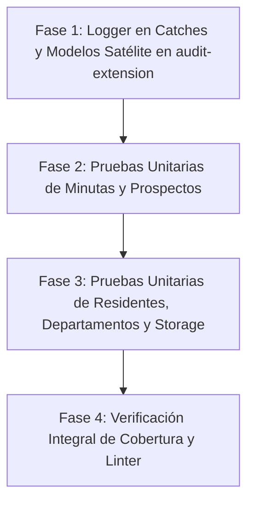

# SPEC-CORE-007: Estandarización de Logger en Bloques Catch, Blindaje de Modelos Satélite Multi-Tenant y Elevación de Cobertura de Pruebas Unitarias al >= 80%

> **Estado**: `COMPLETADO`  
> **Módulo**: `core-architecture / regulation / operation / administrative / notifications / storage`  
> **Autor(es)**: `Software Architect & Lead QA Engineer`  
> **Fecha de Creación**: `2026-10-20`  
> **Última Actualización**: `2026-10-20`  

---

## 1. Contexto de Negocio y Problemática Técnica

Durante la auditoría de integridad del backend de **Noxia API**, se identificaron tres áreas críticas que impactan la observabilidad en producción, el blindaje de seguridad multi-tenant y la confiabilidad del código:

1. **Falta de Trazabilidad en Excepciones (Catch Blocks sin Logger)**:
   - Diversos servicios de dominio en `regulation` y `administrative` capturan excepciones (por ejemplo, errores de base de datos Prisma `P2002` o fallos en generación de estructuras) y las transforman en excepciones HTTP (`ConflictException`, `BadRequestException`) sin emitir un registro mediante `Logger.error(...)`.
   - En entornos de producción (Docker/Render/Railway), esto genera pérdida de contexto forense, impidiendo a los ingenieros de soporte y operaciones correlacionar fallos con logs estructurados y trazas de error (`stack traces`).

2. **Omisión de Modelos Satélite de Tenant en el Sandbox de Auditoría**:
   - La especificación `SPEC-REG-009` introdujo modelos satélite 1-a-1 asociados a la entidad `Tenant`: `TenantProfile`, `TenantSubscription` y `TenantSettings`.
   - Aunque cada uno posee la columna `tenantId String @unique`, no se encuentran declarados dentro del arreglo `multiTenantModels` de [`src/common/prisma-extension/audit-extension.ts`](file:///d:/projects/security-crm-backend/src/common/prisma-extension/audit-extension.ts).
   - Su registro explícito en la extensión de Prisma blindará cualquier consulta directa a nivel de ORM para garantizar que nunca se lean ni modifiquen configuraciones de otros inquilinos.

3. **Brecha de Cobertura de Pruebas Unitarias (< 80%)**:
   - Si bien los módulos principales recientemente refactorizados (`user`, `employee`, `client`, `pqrs.service`, `security-studies`) gozan de coberturas superiores al 80%, módulos y subservicios clave carecen de suites unitarias completas:
     - `prospect` (`prospect.service.ts` y `prospect.controller.ts`: 0%).
     - `operation/minuta` (`visitor-control.service.ts`, `parking-control.service.ts`, `correspondence-control.service.ts` ~5%, `minuta-general.controller.ts` 0%).
     - `administrative/resident` (`resident.controller.ts` 0%, `resident.service.ts` ~33%).
     - `regulation/department` (`department.service.ts` ~7%).
     - `notifications` (`notifications.controller.ts` 0%, `notification.listener.ts` 0%).
     - `storage` (`s3.service.ts` ~11%, `storage.service.ts` ~8%).
   - Esto sitúa la cobertura global en un 57%, incumpliendo el umbral contractual del 80%.

---

## 2. Alcance Técnico y Arquitectura de la Solución

### 2.1 Estandarización de Logger en Bloques `try-catch`

Cada clase que capture errores implementará el patrón oficial de NestJS:
```typescript
import { Injectable, Logger } from '@nestjs/common';

@Injectable()
export class TargetService {
  private readonly logger = new Logger(TargetService.name);

  async someMethod() {
    try {
      // lógica
    } catch (error: any) {
      this.logger.error(`Error en someMethod: ${error?.message || error}`, error?.stack);
      // transformación o rethrow
    }
  }
}
```

#### Archivos a intervenir:
1. `src/modules/regulation/role/role.service.ts`:
   - Inyectar `private readonly logger = new Logger(RoleService.name)`.
   - Agregar `this.logger.error(...)` en los bloques `catch` de `create`, `update`, y `remove`.
2. `src/modules/regulation/position/position.service.ts`:
   - Inyectar `private readonly logger = new Logger(PositionService.name)`.
   - Agregar `this.logger.error(...)` en el bloque `catch` de `importPositions` y cualquier operación Prisma.
3. `src/modules/regulation/department/department.service.ts`:
   - Inyectar `private readonly logger = new Logger(DepartmentService.name)`.
   - Agregar `this.logger.error(...)` en el bloque `catch` de `importDepartments`.
4. `src/modules/regulation/permission/permission.service.ts`:
   - Inyectar `private readonly logger = new Logger(PermissionService.name)`.
   - Agregar `this.logger.error(...)` en `create`, `update`, `remove`.
5. `src/modules/administrative/resident/services/resident.service.ts`:
   - Inyectar `private readonly logger = new Logger(ResidentService.name)`.
   - Agregar `this.logger.error(...)` en `create`, `update`, `importResidents`.
6. `src/modules/administrative/prospect/prospect.service.ts`:
   - En `handlePrismaError`: Registrar `this.logger.error(...)`.
   - En bloques catch de `create`, `update`, `generateStructure`: Registrar `this.logger.error(...)`.
7. `src/modules/administrative/client/client.service.ts`:
   - En `handlePrismaError` y bloques `catch` que carezcan de logging explícito de nivel error: Registrar `this.logger.error(...)`.

---

### 2.2 Blindaje de Modelos Satélite Multi-Tenant (`audit-extension.ts`)

En [`src/common/prisma-extension/audit-extension.ts`](file:///d:/projects/security-crm-backend/src/common/prisma-extension/audit-extension.ts):
```typescript
const multiTenantModels = [
  'User',
  'Employee',
  'Role',
  'Department',
  'Position',
  'Client',
  'ClientProperties',
  'Resident',
  'Tower',
  'Floor',
  'Unit',
  'Minuta',
  'VisitorEntryControl',
  'CorrespondenceReceivedControl',
  'ParkingResidentVehicleControl',
  'MediaAttachment',
  'FileImportLog',
  'SecurityStudy',
  'PqrsTicket',
  'PqrsMessage',
  'Notification',
  'UserClientAccess',
  // Modelos Satélite Tenant (SPEC-REG-009)
  'TenantProfile',
  'TenantSubscription',
  'TenantSettings',
];
```

Además, en [`src/common/prisma-extension/audit-extension.spec.ts`](file:///d:/projects/security-crm-backend/src/common/prisma-extension/audit-extension.spec.ts), se agregarán pruebas unitarias para validar la inyección automática de `tenantId` en operaciones sobre `TenantProfile`, `TenantSubscription` y `TenantSettings`.

---

### 2.3 Elevación de Cobertura de Pruebas Unitarias (>= 80%)

Se crearán e implementarán suites de pruebas Jest unitarias para los siguientes componentes críticos:

| Módulo | Archivo Objetivo | Nueva Suite Jest | Objetivos de Cobertura |
| :--- | :--- | :--- | :--- |
| `administrative/prospect` | `prospect.service.ts` | `prospect.service.spec.ts` | >= 85% (CRUD, filtros, estructura, P2002) |
| `administrative/prospect` | `prospect.controller.ts` | `prospect.controller.spec.ts` | 100% (Rutas, DTO delegation, decorators) |
| `administrative/resident` | `resident.controller.ts` | `resident.controller.spec.ts` | 100% (Controlador REST, permisos, filtros) |
| `administrative/resident` | `resident.service.ts` | `resident.service.spec.ts` (expansión) | >= 80% (CRUD, validación OWNER única, CSV) |
| `operation/minuta` | `minuta-general.controller.ts` | `minuta-general.controller.spec.ts` | 100% (Endpoints, Guards, RBAC) |
| `operation/minuta` | `visitor-control.service.ts` | `visitor-control.service.spec.ts` | >= 85% (Entrada, Salida, Paginación cursor) |
| `operation/minuta` | `parking-control.service.ts` | `parking-control.service.spec.ts` | >= 85% (Entrada/Salida vehículos, filtros) |
| `operation/minuta` | `correspondence-control.service.ts` | `correspondence-control.service.spec.ts` | >= 85% (Recepción, Entrega, Paquetería) |
| `regulation/department` | `department.service.ts` | `department.service.spec.ts` | >= 85% (CRUD, normalización nombre, P2002) |
| `notifications` | `notifications.controller.ts` | `notifications.controller.spec.ts` | 100% (Lectura, Conteos, SSE delegation) |
| `notifications` | `notification.listener.ts` | `notification.listener.spec.ts` | 100% (Eventos PQRS emitidos a SSE y DB) |
| `storage` | `storage.service.ts` & `s3.service.ts` | `storage.service.spec.ts` & `s3.service.spec.ts` | >= 80% (Presigned URLs, validación tipos) |

---

## 3. Plan de Implementación por Fases



- **Fase 1: Trazabilidad y Blindaje Multi-Tenant**:
  1. Incorporar `Logger` y llamadas a `logger.error` en `RoleService`, `PositionService`, `DepartmentService`, `PermissionService`, `ResidentService`, `ProspectService` y `ClientService`.
  2. Agregar `TenantProfile`, `TenantSubscription` y `TenantSettings` a `multiTenantModels` en `audit-extension.ts`.
  3. Ejecutar y extender `audit-extension.spec.ts`.

- **Fase 2: Cobertura en Operaciones (Minutas) y Comercial (Prospectos)**:
  1. Crear `prospect.controller.spec.ts` y `prospect.service.spec.ts`.
  2. Crear `minuta-general.controller.spec.ts`.
  3. Crear `visitor-control.service.spec.ts`, `parking-control.service.spec.ts` y `correspondence-control.service.spec.ts`.

- **Fase 3: Cobertura en Administración, Notificaciones y Storage**:
  1. Crear `resident.controller.spec.ts` y ampliar `resident.service.spec.ts`.
  2. Crear `department.service.spec.ts`.
  3. Crear `notifications.controller.spec.ts` y `notification.listener.spec.ts`.
  4. Crear `storage.service.spec.ts` y `s3.service.spec.ts`.

- **Fase 4: Calidad y Verificación**:
  1. Ejecutar `npm run test:cov` para constatar que los módulos modificados y críticos superen el 80% de cobertura.
  2. Ejecutar `npx tsc --noEmit` y `npm run lint`.
  3. Registrar todas las decisiones y adiciones en `ai-decisions.log`.

---

## 4. Criterios de Aceptación

- [x] **Logger**: Ningún bloque `try-catch` en los servicios de dominio omite el registro con `logger.error`.
- [x] **Modelos Satélite**: `TenantProfile`, `TenantSubscription` y `TenantSettings` forman parte de `multiTenantModels` y sus queries inyectan automáticamente `tenantId`.
- [x] **Cobertura >= 80%**: Las nuevas suites de pruebas unitarias alcanzan y superan el 80% de cobertura en cada uno de los servicios implementados (prospect, minuta, resident, department, notifications, storage).
- [x] **Calidad**: 0 errores en `tsc --noEmit`, 0 errores en ESLint y todas las suites de prueba ejecutándose en verde (49/49 suites, 501/501 pruebas pasando).
- [x] **Bitácora**: `ai-decisions.log` actualizado con la especificación y decisiones técnicas.
