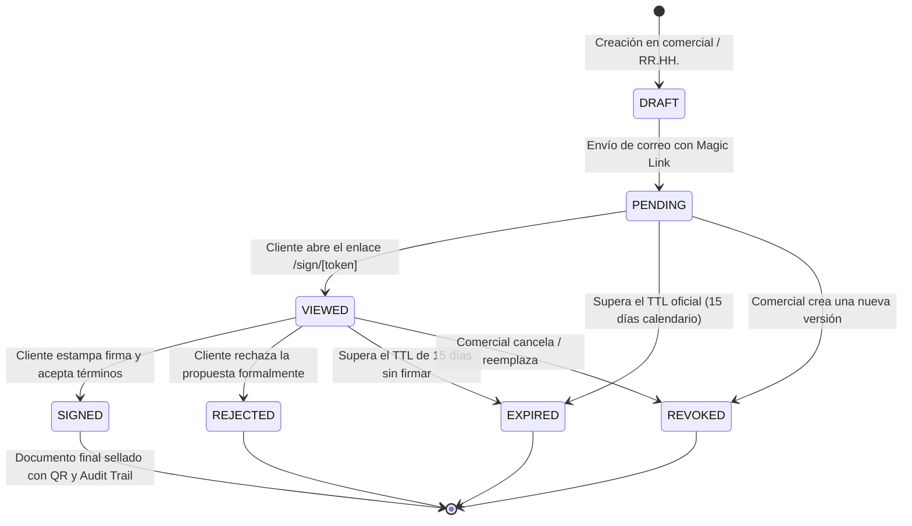

# SPEC-CORE-009: Motor de Firmas Digitales In-House (Noxia Sign), Ciclo de Vida de Documentos Auditables y Gestión de Firma en Perfil/Configuración

> **Estado**: `APROBADO (LISTO PARA IMPLEMENTACIÓN)`  
> **Módulo**: `core / signatures / document-lifecycle / administrative / settings`  
> **Autor(es)**: `Software Architect & Lead Security Engineer`  
> **Fecha de Creación**: `2026-10-21`  
> **Última Actualización**: `2026-10-21`  

---

## 1. Contexto de Negocio e Historias de Usuario

### 1.1 Objetivo del Módulo
El ecosistema **Noxia ERP & Security CRM** gestiona flujos documentales críticos en empresas de seguridad privada: cotizaciones de servicios de vigilancia, ofertas técnicas, órdenes de servicio (promesas de compra), contratos laborales de guardas, actas de entrega de dotación/armamento y minutas operativas. 

Actualmente, depender de proveedores externos SaaS como DocuSign o PandaDoc introduce fricción operativa, cobros recurrentes de entre $25 y $50 USD mensuales por usuario, límites artificiales en sobres de envío (*envelopes*), interfaces desalineadas con la marca blanca del tenant y dificultades para cumplir con la legislación colombiana de comercio electrónico (**Ley 527 de 1999** y Decreto 2364 de 2012).

**SPEC-CORE-009** establece la arquitectura completa para:
1. **Configurador de Firma Personal del Usuario**: Permitir que cualquier usuario del sistema (directivo, comercial, supervisor o guarda) cree, personalice y almacene su firma digital directamente desde la sección de **Configuraciones / Perfil** a través de tres modalidades (Dibujo en pantalla táctil con `signature_pad`, tipografía caligráfica asistida por Canvas o subida de imagen con umbralización transparente en el cliente).
2. **Noxia Sign (Motor In-House de Firma Externa)**: Envío automático de documentos hacia clientes externos mediante enlaces seguros (*magic links* tokenizados), visor interactivo en pestaña pública cifrada (`/sign/[token]`), registro de evidencias en tiempo real (`VIEWED`, `SIGNED`), congelamiento vectorial en S3 (35 KB - 80 KB) y generación de la **Hoja de Evidencias con Código QR de Validación Pública**.
3. **Almacenamiento Óptimo en Dos Fases**: Borradores y versiones en negociación guardados exclusivamente como datos estructurados en PostgreSQL (`@db.JsonB` de 3 KB, 0 bytes en S3), y compilación vectorial definitiva en S3 solo cuando el documento alcanza un estado legal inmutable.
4. **Garantía de Calidad**: Cobertura de pruebas unitarias y de integración superior al **80%** en backend y frontend.

---

### 1.2 Historias de Usuario (User Stories)

* **US-01 (Firma en Perfil de Usuario)**: Como **Usuario del Sistema (Comercial/Directivo/Guarda)**, quiero registrar mi firma digital en mi perfil de configuración (dibujándola, escribiéndola o subiendo una foto de mi firma en papel con eliminación automática de fondo blanco) para que el ERP la estampe automáticamente en cotizaciones, actas, minutas y formatos autorizados sin necesidad de firmar manualmente en papel.
* **US-02 (Solicitud de Firma Externa)**: Como **Asesor Comercial / Director de Operaciones**, quiero emitir una Cotización u Orden de Servicio y presionar *"Enviar a Firma del Cliente"* para que se genere un enlace cifrado de un solo uso y se envíe un correo corporativo formal al cliente con el botón *"Firmar Documento"*.
* **US-03 (Trazabilidad de Apertura)**: Como **Asesor Comercial**, quiero recibir una notificación en tiempo real cuando el cliente abra por primera vez el enlace de firma (transición a estado `VIEWED`) para conocer su nivel de interés y dar seguimiento proactivo.
* **US-04 (Experiencia de Firma del Cliente)**: Como **Cliente / Comprador Externo**, quiero abrir el enlace en mi celular o computador sin necesidad de crear cuenta ni recordar contraseñas, revisar el documento en alta resolución vectorial, firmar en pantalla o con texto asistido, aceptar los términos legales con un clic y recibir de inmediato una copia sellada en PDF.
* **US-05 (Auditoría e Integridad Pública)**: Como **Auditor / Interventor / Oficial de Cumplimiento**, quiero escanear el código QR impreso al final del documento PDF firmado para verificar al instante en `https://crm.noxia.com/verify/[id]` que el archivo no ha sido manipulado, validando la huella digital criptográfica SHA-256, la fecha/hora UTC exacta y la IP del firmante.

---

## 2. Componente 1: Gestor de Firma de Usuario en Perfil / Configuraciones

### 2.1 Ubicación en la Plataforma
* **Ruta de Configuración Personal**: `/settings` (pestaña *"Mi Firma Digital"*).
* **Ruta de Administración de Usuarios**: `/administrative/users` (dentro de la ficha de edición de cada usuario, accesible por Administradores de Seguridad y RR.HH.).
* **Ruta de Ficha del Empleado**: `/administrative/employees/[id]/account`.

### 2.2 Las 3 Modalidades de Creación de Firma

```
+-------------------------------------------------------------------------------+
|                        CONFIGURAR MI FIRMA DIGITAL                            |
+-------------------------------------------------------------------------------+
|  [ ✍️ Dibujar en Pantalla ]   [ ⌨️ Escribir Texto ]   [ 📁 Subir Imagen PNG ]   |
+-------------------------------------------------------------------------------+
|                                                                               |
|   +-----------------------------------------------------------------------+   |
|   |                                                                       |   |
|   |                        (Área de Canvas Activa)                         |   |
|   |                                                                       |   |
|   +-----------------------------------------------------------------------+   |
|                                                                               |
|   [ Deshacer ]   [ Limpiar Lienzo ]       Color: (•) Azul Notarial  ( ) Negro |
|                                                                               |
|   (Solo modo Subir): [ Slider Sensibilidad / Limpieza Fondo: 75% ]            |
|                                                                               |
+-------------------------------------------------------------------------------+
|  [ Cancelar ]                                       [ Guardar Firma Digital ] |
+-------------------------------------------------------------------------------+
```

#### Modalidad A: Dibujo en Pantalla (`signature_pad` v5 nativo)
* **Motor**: Librería nativa `signature_pad` (TypeScript puro, sin wrappers obsoletos).
* **Calidad de Trazo**:
  * Compensación automática de densidad de pantalla (`window.devicePixelRatio`) para nitidez perfecta en pantallas Retina/OLED de móviles y laptops.
  * Curvas de Bézier con algoritmo de velocidad: el grosor de la línea varía de forma orgánica según la velocidad de la mano (`minWidth: 1.2`, `maxWidth: 3.5`).
* **Colores Notariales**: Selector rápido entre **Azul Notarial** (`#1E3A8A` - estándar bancario y legal en Colombia para distinguir firma original de fotocopia) y **Negro Profundo** (`#0F172A`).
* **Exportación**: Generación de DataURL PNG transparente recortado (*trimmed* sin márgenes vacíos) y opción de exportación a SVG vectorial.

#### Modalidad B: Escribir con Fuentes Caligráficas (Type to Sign)
* **Funcionamiento**:
  1. El usuario digita su nombre completo en un campo de texto.
  2. El sistema renderiza el nombre en tiempo real utilizando 4 familias tipográficas caligráficas cargadas desde Google Fonts:
     * *Caveat* (estilo fluido y moderno).
     * *Dancing Script* (estilo elegante y formal).
     * *Great Vibes* (estilo caligráfico clásico de pluma fuente).
     * *Sacramento* (estilo sobrio y ejecutivo).
  3. Al seleccionar el estilo deseado, un `<canvas>` oculto en memoria dibuja el texto mediante `ctx.fillText(...)` y exporta el PNG transparente de alta definición.

#### Modalidad C: Subir Foto de Firma con Umbralización en Cliente (Thresholding)
* **Objetivo**: Permitir que el usuario firme en una hoja blanca de papel, le tome una foto con su smartphone y el sistema remueva el papel blanco y las sombras en menos de 10 ms sin tocar el servidor.
* **Rendimiento e Impacto**:
  * Consumo en Servidor: **0% CPU / 0% RAM** (se ejecuta totalmente en el navegador).
  * Consumo en Cliente: **3 a 8 milisegundos** sobre un `Uint8ClampedArray`.
* **Algoritmo de Procesamiento**:
  1. **Redimensión Previa**: La imagen cargada se escala a un tamaño máximo de `800 × 400` píxeles para evitar procesar fotos masivas de 48 MP.
  2. **Cálculo de Luminancia**: Para cada píxel $[R, G, B, A]$, se obtiene su luminancia perceptual:
     $$Y = 0.299 \times R + 0.587 \times G + 0.114 \times B$$
  3. **Filtro Alfa de Umbral (Threshold)**: Si $Y > \text{umbral}$, el píxel se considera fondo blanco/gris y su canal alfa se fija en `0` (100% transparente). Si $Y \le \text{umbral}$, se conserva como trazo de tinta.
  4. **Slider de Sensibilidad (10% a 90%)**: Control deslizante interactivo en pantalla que recalcula el canvas en tiempo real para que el usuario pueda limpiar sombras si tomó la foto con luz tenue.

---

## 3. Componente 2: Noxia Sign - Motor de Firma Externa y Ciclo de Vida Documental

### 3.1 Estrategia de Almacenamiento en Dos Fases

```
   [ FASE 1: NEGOCIACIÓN / BORRADOR ]             [ FASE 2: DEFINITIVO / LEGAL ]
 ┌───────────────────────────────────┐         ┌─────────────────────────────────┐
 │ • Modificación de ítems y precios │         │ • Documento aprobado / firmado  │
 │ • Estado: DRAFT / NEGOTIATION     │         │ • Estado: SENT / SIGNED         │
 │ • Almacenamiento: PostgreSQL      │         │ • Compilación: Vectorial nativo │
 │   Columna: documentSnapshot JsonB │───────► │ • Almacenamiento: AWS S3        │
 │ • Peso: ~3 KB por registro        │         │   Registrado en MediaAttachment │
 │ • Render: @react-pdf/renderer     │         │ • Peso: 35 KB - 80 KB           │
 │   al vuelo en memoria (<300ms)    │         │ • Calidad: Vectorial inalterable│
 │ • Costo S3: $0.00 (0 bytes)       │         │ • Hash SHA-256 inmutable        │
 └───────────────────────────────────┘         └─────────────────────────────────┘
```

1. **Fase 1 - Borradores y Cotizaciones Dinámicas**:
   * Mientras una propuesta comercial u orden de compra se encuentre en edición, no se genera ningún archivo en S3.
   * Se almacena un snapshot canónico en formato JSON (`@db.JsonB`) que contiene los datos del cliente, condiciones de servicio, puestos de vigilancia, tarifas y desglose de impuestos.
   * La previsualización se realiza en el frontend/backend usando `@react-pdf/renderer`, dibujando el PDF en memoria en menos de 300 ms.
2. **Fase 2 - Congelamiento Vectorial en S3**:
   * Al hacer clic en *"Enviar a Firma"*, el backend compila el PDF vectorial inmutable utilizando `@react-pdf/renderer` o `pdf-lib`.
   * El archivo resultante pesa únicamente entre **35 KB y 80 KB** (a diferencia de los 5 MB a 10 MB que producen librerías basadas en capturas HTML como `html2canvas` o `puppeteer`).
   * Se sube a AWS S3 / MinIO bajo la ruta:
     `{tenantId}/documents/{year}/{documentType}_{documentId}_{hash}.pdf`
   * Se crea un registro formal en la tabla `media_attachments`.

---

### 3.2 Máquina de Estados del Documento (`SignatureStatus`)



* **`DRAFT`**: Documento en preparación interna; no accesible por el cliente externo.
* **`PENDING`**: Magic Link generado y correo transaccional despachado al firmante.
* **`VIEWED`**: Detectado el primer acceso del cliente. Registra IP, User-Agent y timestamp exacto; dispara notificación en tiempo real vía Server-Sent Events (SSE) al asesor comercial: *"El cliente ha visualizado la propuesta"*.
* **`SIGNED`**: Firma capturada exitosamente, estampada en el PDF con `pdf-lib` junto a la Hoja de Evidencias y notificada a ambas partes con copia adjunta.
* **`REJECTED`**: El cliente rechaza la firma indicando un motivo textual de discrepancia.
* **`EXPIRED`**: Enlace caducado por superar el TTL inmutable de **15 días calendario**.
* **`REVOKED`**: Enlace anulado por la empresa al emitir una versión corregida del documento.

---

### 3.3 Seguridad del Portal de Firma Externa (`/sign/[token]`)
* **Acceso mediante Magic Link**: Ruta pública sin autenticación previa requerida, alojada en el frontend Next.js:
  $$\text{URL de Firma} = \texttt{\$\{FRONTEND\_URL\}/sign/\$\{token\}}$$
  *(Ejemplo local: `http://localhost:3000/sign/a8f9b...`, Ejemplo Vercel: `https://tu-proyecto.vercel.app/sign/a8f9b...`)*.
* **Seguridad Criptográfica**: El token es un valor opaco aleatorio de alta entropía (64 caracteres hexadecimales) generado con `crypto.randomBytes(32).toString('hex')`. Es computacionalmente imposible de adivinar o iterar.
* **TTL Estándar Inmutable (15 Días)**: Toda solicitud de firma nace con una fecha de expiración fijada a **15 días calendario** (`expiresAt = new Date(Date.now() + 15 * 24 * 60 * 60 * 1000)`).
* **Token de Un Solo Uso para Firma**: Una vez que el estado pasa a `SIGNED`, el token se bloquea para nuevas escrituras y la URL pasa a operar exclusivamente en modo consulta y descarga del PDF final sellado.
* **Doble Factor de Seguridad (OTP Opcional por Tenant)**: Para contratos u órdenes de compra de alta cuantía, el tenant puede configurar la exigencia de un código de 6 dígitos enviado al correo electrónico del cliente antes de habilitar el botón de firma.
* **Hoja de Cierre Automatizada**: El generador de PDF coloca automáticamente los bloques de firma al pie del documento (Representante Legal del Tenant y Aceptante/Cliente) sin requerir que el comercial arrastre cajas manualmente.

---

### 3.4 Hoja de Evidencias y Validez Jurídica (Ley 527 de 1999)

Todo documento firmado incorpora automáticamente una página final denominada **Certificado de Firma y Pista de Auditoría**, la cual contiene:

1. **Metadatos de Identidad**:
   * Nombre completo, correo electrónico y número de documento (C.C. o NIT) del firmante.
   * Nombre y NIT de la empresa de seguridad emisora (Tenant).
2. **Trazabilidad Criptográfica**:
   * **Hash SHA-256 del Documento Original**: Huella criptográfica del PDF antes de ser firmado.
   * **Hash SHA-256 del Documento Final**: Huella criptográfica del PDF con la firma y el certificado incrustados.
   * **Identificador Único de Transacción**: UUID v4 inmutable.
3. **Evidencias Técnicas**:
   * Dirección IP pública registrada en el servidor de Noxia al momento de la firma.
   * Agente de usuario (*User-Agent*: sistema operativo, navegador y tipo de dispositivo).
   * Fecha y hora precisa en zona horaria UTC y hora local colombiana (COT / UTC-5).
4. **Declaración Legal Explícita**:
   > *"El firmante declara bajo la gravedad de juramento haber revisado el contenido de este documento, aceptando expresamente los términos, condiciones y compromisos estipulados en él, reconociendo la plena validez jurídica y probatoria de su firma electrónica conforme a lo dispuesto en la Ley 527 de 1999 y el Decreto 2364 de 2012 de la República de Colombia."*
5. **Código QR de Verificación Pública**:
   * QR dinámico estampado al final del PDF que apunta a:  
     $$\text{URL de Verificación} = \texttt{\$\{FRONTEND\_URL\}/verify/\$\{signatureRequestId\}}$$
     *(Ejemplo en Vercel: `https://mi-dominio.vercel.app/verify/cm2...` o con dominio propio: `https://crm.noxia.com/verify/cm2...`)*.
   * Al ser escaneado con cualquier cámara móvil desde el PDF digital o impreso en papel, despliega un portal oficial de verificación pública que corrobora la autenticidad e integridad del documento en tiempo real contra la base de datos de PostgreSQL.

---

## 4. Definición de Permisos y Matriz RBAC

Los siguientes permisos se integran en el sistema de RBAC y se cargan en la semilla de datos:

| Permiso Code | Nombre Legible | Descripción | Roles Autorizados |
| :--- | :--- | :--- | :--- |
| `signatures:profile:manage` | Gestionar Firma Personal | Crear, actualizar y eliminar la propia firma digital en configuración | Todos los usuarios activos |
| `signatures:request:create` | Emitir Solicitudes de Firma | Generar Magic Links y enviar documentos a clientes externos | Comercial, Directores, Admin |
| `signatures:request:read` | Consultar Solicitudes | Ver el estado de firmas, aperturas y pistas de auditoría | Comercial, Operaciones, Admin |
| `signatures:request:revoke` | Revocar / Anular Solicitudes | Cancelar un enlace de firma pendiente y forzar expiración | Comercial, Directores, Admin |
| `signatures:verify:public` | Verificación Pública | Acceso libre a la API de consulta de autenticidad por hash/QR | Público (sin token JWT) |

---

## 5. Especificación del Modelo de Datos (Prisma Schema)

Archivo: `prisma/schema/signature.prisma`

```prisma
// ============================================================================
// SPEC-CORE-009: Motor de Firmas Digitales y Ciclo de Vida de Documentos
// ============================================================================

enum SignatureStatus {
  DRAFT
  PENDING
  VIEWED
  SIGNED
  REJECTED
  EXPIRED
  REVOKED
}

enum SignatureDocumentType {
  QUOTATION
  PURCHASE_ORDER
  SERVICE_ORDER
  EMPLOYMENT_CONTRACT
  EQUIPMENT_DELIVERY
  OPERATIONAL_MINUTE
  GENERAL_FORMAT
}

enum SignatureCreationMode {
  DRAW
  TYPE
  UPLOAD
}

model SignatureRequest {
  id              String                @id @default(cuid(2))
  tenantId        String
  tenant          Tenant                @relation(fields: [tenantId], references: [id], onDelete: Restrict)

  // Documento asociado
  documentType    SignatureDocumentType
  documentId      String                // ID del registro comercial/operativo
  documentTitle   String                // Ej: "Orden de Servicio OS-2026-0042"
  documentVersion Int                   @default(1)

  // Datos estructurados en borrador (0 bytes en S3)
  draftSnapshot   Json?                 // Snapshot estructurado JSONB del documento

  // Token Criptográfico de Acceso Público
  token           String                @unique // Token aleatorio de 64 caracteres hex
  expiresAt       DateTime

  // Información del Firmante
  signerName      String
  signerEmail     String
  signerDocument  String?               // Cédula de ciudadanía o NIT
  signerPhone     String?
  signerRole      String?               // Ej: "Representante Legal / Gerente"

  // Estado del Flujo
  status          SignatureStatus       @default(DRAFT)
  rejectionReason String?

  // Pista de Auditoría e Inmutabilidad (Ley 527 de 1999)
  originalDocHash String?               // Hash SHA-256 del PDF base
  signedDocHash   String?               // Hash SHA-256 del PDF final firmado
  signatureMethod SignatureCreationMode?
  signatureIp     String?
  signatureUa     String?               // User-Agent del navegador
  signatureImage  String?               // DataURL o path del PNG de firma

  // Timestamps de Ciclo de Vida
  sentAt          DateTime?
  viewedAt        DateTime?
  signedAt        DateTime?
  revokedAt       DateTime?

  // OTP Opcional (Doble Factor)
  otpCodeHash     String?
  otpExpiresAt    DateTime?

  // Relación con el Archivo Oficial Congelado en S3
  mediaAttachmentId String?
  mediaAttachment   MediaAttachment?    @relation(fields: [mediaAttachmentId], references: [id], onDelete: SetNull)

  // Metadatos de Auditoría Interna
  createdById     String?
  createdBy       User?                 @relation("SignatureRequestsCreated", fields: [createdById], references: [id], onDelete: SetNull)
  createdAt       DateTime              @default(now())
  updatedAt       DateTime              @updatedAt

  @@index([tenantId])
  @@index([tenantId, status])
  @@index([token])
  @@index([documentType, documentId])
  @@map("signature_requests")
}
```

### Extensión en Modelos `User` y `Employee`:
En `prisma/schema/identity.prisma` y `prisma/schema/employee.prisma`:
```prisma
// Campos añadidos a User y Employee:
signatureUrl         String?                // Ruta en S3/MinIO al PNG transparente
signatureMethod      SignatureCreationMode? // DRAW, TYPE, UPLOAD
signatureUpdatedAt   DateTime?              // Fecha de última actualización de firma
```

---

## 6. Contratos de API REST (NestJS)

### 6.1 Módulo en Backend
* **Ruta Base**: `src/modules/signatures/`
  * `signatures.module.ts`
  * `controllers/user-signature.controller.ts` (Gestión de firma en configuración/perfil)
  * `controllers/signature-request.controller.ts` (Gestión interna de solicitudes ERP)
  * `controllers/public-signature.controller.ts` (Portal público sin autenticación)
  * `services/signature-generator.service.ts` (Compilación vectorial y estampado `pdf-lib`)
  * `services/signature-audit.service.ts` (Generación de hashes SHA-256 y Hoja de Evidencias)

### 6.2 Endpoints REST Especificados

#### A. Gestión de Firma del Usuario (Perfil / Configuración)
* **`GET /api/v1/users/me/signature`**: Retorna la firma configurada del usuario actual.
* **`POST /api/v1/users/me/signature`**:
  * Body: `{ signatureDataUrl: string, method: "DRAW" | "TYPE" | "UPLOAD" }`
  * Valida formato PNG, optimiza en memoria y almacena en almacenamiento del tenant.
* **`DELETE /api/v1/users/me/signature`**: Elimina la firma registrada del perfil.

#### B. Gestión de Solicitudes de Firma (Uso Interno ERP)
* **`POST /api/v1/signatures/requests`**:
  * Body: `{ documentType, documentId, signerName, signerEmail, signerDocument, draftSnapshot, expiresDays?: 15 }`
  * Genera el token criptográfico (64 hex), guarda snapshot JSONB, fija `status: PENDING`, establece expiración en 15 días calendario y despacha el correo transaccional.
* **`GET /api/v1/signatures/requests/:id`**: Consulta detalle, estado actual y pista de auditoría.
* **`POST /api/v1/signatures/requests/:id/revoke`**: Revoca el enlace inmediatamente.

#### C. Portal Público Cifrado (Sin Autenticación JWT)
* **`GET /api/v1/public/signatures/:token`**:
  * Valida token y expiración.
  * Si el estado es `PENDING`, actualiza de inmediato a `VIEWED` (registrando IP y User-Agent) y emite evento SSE de apertura.
  * Retorna datos seguros del documento y stream del PDF vectorial compilado.
* **`POST /api/v1/public/signatures/:token/sign`**:
  * Body: `{ signatureDataUrl: string, method: "DRAW" | "TYPE" | "UPLOAD", acceptedTerms: boolean }`
  * Verifica `acceptedTerms === true`.
  * Calcula hashes SHA-256 (original y final).
  * Estampa la firma en el documento usando `pdf-lib`.
  * Concatena la Hoja de Evidencias con el Código QR de verificación.
  * Sube el PDF congelado definitivo a AWS S3 (35 KB - 80 KB).
  * Actualiza estado a `SIGNED` y envía correo de confirmación con PDF adjunto a ambas partes.
* **`GET /api/v1/public/verify/:id`**:
  * Valida la autenticidad del documento mediante escaneo del código QR, retornando los hashes y metadatos públicos de auditoría.

### 6.3 Configuración de Variables de Entorno (.env) en Render y Vercel

Dado que el frontend (Next.js) y el backend (NestJS) se despliegan de forma desacoplada (Vercel y Render respectivamente) y el dominio definitivo puede variar según el entorno, las URLs de firma y verificación **se parametrizan dinámicamente mediante variables de entorno**:

#### A. En el Backend (NestJS en Render / `.env` local):
El backend es el encargado de generar los correos con el botón de firma y de estampar el código QR en el PDF final. Requiere:

```bash
# URL pública donde está alojado el frontend (Next.js)
# En desarrollo local:
FRONTEND_URL=http://localhost:3000

# En producción (Render -> Environment Variables):
# Mientras no se tenga dominio propio:
FRONTEND_URL=https://noxia-security-crm.vercel.app
# Cuando se adquiera el dominio definitivo:
# FRONTEND_URL=https://crm.noxia.com

# TTL oficial inmutable de solicitudes de firma (en días)
SIGNATURE_TOKEN_TTL_DAYS=15
```

* **Composición en el Backend**:
  * Enlace para el botón del correo electrónico:
    ```typescript
    const signUrl = `${process.env.FRONTEND_URL}/sign/${signatureRequest.token}`;
    ```
  * Enlace incrustado dentro del Código QR en el PDF:
    ```typescript
    const verifyUrl = `${process.env.FRONTEND_URL}/verify/${signatureRequest.id}`;
    ```

#### B. En el Frontend (Next.js en Vercel / `.env.local`):
El frontend aloja las páginas públicas `/sign/[token]` y `/verify/[id]`:

```bash
# URL del backend NestJS
NEXT_PUBLIC_API_URL=https://noxia-backend.onrender.com/api/v1

# URL pública propia del frontend (opcional para canónicos y SEO)
NEXT_PUBLIC_APP_URL=https://noxia-security-crm.vercel.app
```

> **Ventaja Arquitectónica**: Cuando compres y configures tu dominio definitivo (ej. `crm.noxia.com`), solo cambias la variable `FRONTEND_URL` en el panel de Render y `NEXT_PUBLIC_APP_URL` en Vercel, **sin tener que modificar ni una sola línea de código**.

---

## 7. Estrategia y Suite de Pruebas Unitarias (Cobertura Mínima >= 80%)

Para dar cumplimiento estricto a la exigencia de **cobertura mínima del 80%**, se diseñan suites de pruebas automatizadas en Jest/Supertest para backend y Vitest/RTL para frontend:

### 7.1 Matriz de Cobertura de Pruebas Backend (NestJS / Jest)

| Archivo / Módulo | Casos de Prueba Críticos | Cobertura Esperada |
| :--- | :--- | :--- |
| `signature-generator.service.spec.ts` | 1. Renderizado en memoria de PDF virtual a partir de snapshot JSONB.<br>2. Estampado de firma PNG transparente en coordenadas calculadas.<br>3. Generación vectorial inalterable pesando < 85 KB.<br>4. Incrustación de Hoja de Evidencias con código QR dinámico. | **>= 85%** |
| `signature-audit.service.spec.ts` | 1. Cálculo correcto y determinista de hash SHA-256.<br>2. Detección de alteración de un solo byte en el documento (anti-tampering).<br>3. Formateo legal de fecha/hora en zona UTC y COT. | **>= 90%** |
| `public-signature.controller.spec.ts` | 1. Transición exitosa de `PENDING` a `VIEWED` en primera lectura.<br>2. Rechazo con HTTP 410 Gone si el token está expirado.<br>3. Rechazo con HTTP 403 Forbidden si el token fue revocado.<br>4. Prohibición de sobreescritura si el documento ya está `SIGNED`. | **>= 85%** |
| `user-signature.controller.spec.ts` | 1. Guardado de firma en perfil propio.<br>2. Rechazo de payloads que no sean imágenes PNG válidas.<br>3. Aislamiento estricto multi-tenant (Usuario de Tenant A no modifica Tenant B). | **>= 85%** |

### 7.2 Matriz de Cobertura de Pruebas Frontend (Next.js / Vitest / RTL)

| Componente / Hook | Casos de Prueba Críticos | Cobertura Esperada |
| :--- | :--- | :--- |
| `useSignatureThreshold.spec.ts` | 1. Procesamiento de imagen en Canvas aplicando luminancia $0.299R + 0.587G + 0.114B$.<br>2. Transparencia de canal alfa ($A=0$) para píxeles mayores al umbral.<br>3. Respuesta fluida (< 10 ms) ante cambios en el Slider de Sensibilidad.<br>4. Manejo elegante de imágenes corruptas o archivos no válidos. | **>= 90%** |
| `UserSignatureDialog.spec.tsx` | 1. Renderizado y alternancia entre pestañas (Dibujo, Texto, Subida).<br>2. Inicialización limpia de `signature_pad` nativo.<br>3. Renderizado de fuentes caligráficas (*Caveat*, *Dancing Script*) a DataURL.<br>4. Deshabilitación de botón de guardado si el lienzo está vacío. | **>= 80%** |
| `PublicSignPage.spec.tsx` | 1. Carga inicial del documento y renderizado de páginas PDF.<br>2. Bloqueo de firma si el checkbox de términos legales no está marcado.<br>3. Envío exitoso de firma y transición visual a pantalla de éxito/descarga.<br>4. Visualización de advertencia si el token caducó. | **>= 80%** |

### 7.3 Métricas Globales de Aceptación (CI/CD Quality Gate)
* **Statements**: $\ge 80\%$
* **Branches**: $\ge 80\%$
* **Functions**: $\ge 80\%$
* **Lines**: $\ge 80\%$
* **Aislamiento Multi-Tenant**: 100% de los endpoints de negocio deben verificar `tenantId`.

---

## 8. Cronograma de Implementación

1. **Fase 1 (Backend Core & Esquema)**:
   - Crear `prisma/schema/signature.prisma`, migración de base de datos y modelo `SignatureRequest`.
   - Implementar `SignatureAuditService` (hashes SHA-256) y `SignatureGeneratorService` (`pdf-lib`).
   - Crear endpoints en `UserSignatureController` y `SignatureRequestController`.
2. **Fase 2 (Frontend Configuraciones & Perfil)**:
   - Implementar componente `SignatureCanvasModal` con las 3 modalidades y filtro de contraste en cliente.
   - Conectar pestaña *"Mi Firma Digital"* en `/settings` y en `/administrative/users`.
3. **Fase 3 (Portal Público & Hoja de Evidencias con QR)**:
   - Desarrollar página pública `/sign/[token]` y endpoint público de firma.
   - Integrar generación de código QR de verificación y página pública `/verify/[id]`.
4. **Fase 4 (Pruebas Unitarias y Calidad)**:
   - Construir suite de pruebas Jest y Vitest alcanzando cobertura $\ge 80\%$.
   - Validar compilación de producción en Next.js Turbopack y NestJS build.
