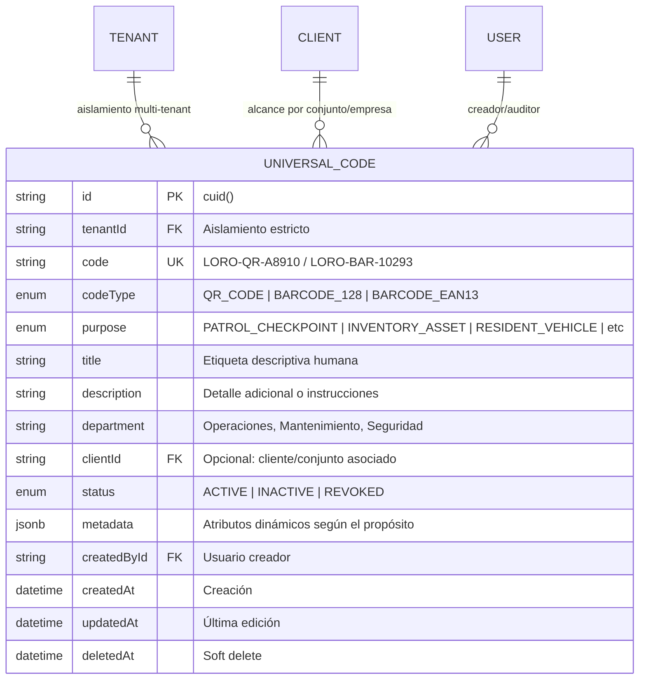

# `SPEC-CORE-013`: Rebranding Institucional "Loro ERP", Dashboard Ejecutivo con Alertas de ANS, Registro Universal de Códigos (QR y Barras) y Suite Modular Loro Toolbox

> **Estado**: `IMPLEMENTADO Y VALIDADO (100% GREEN)`  
> **Módulos Principales**: `core`, `administrative/dashboard`, `tools/universal-codes`, `tools/formats`, `navigation`, `theme`  
> **Código de Especificación**: `SPEC-CORE-013-loro-erp-rebranding-dashboard-and-universal-toolbox`  
> **Autor**: Senior Software Architect & Lead Systems Engineer  
> **Fecha de Creación**: 2026-11-03  
> **Última Actualización**: 2026-11-03  
> **Ubicación Backend**:
> - `prisma/schema/universal_codes.prisma` (nueva partición de esquema para códigos de marcación y activos)
> - `src/modules/tools/universal-codes/` (módulo de registro, resolución y trazabilidad de códigos)
> - `src/modules/administrative/dashboard/` (módulo de KPIs consolidados, cumplimiento de ANS y motor de recordatorios)
> - `src/main.ts` (rebranding de la documentación OpenAPI Swagger a Loro ERP API)
> **Ubicación Frontend**:
> - `src/config/navigationRegistry.ts` (depuración de ajustes y reordenamiento de herramientas)
> - `src/components/navigation/GeneralToolsDrawer.tsx` (Loro Toolbox: códigos de barra, QR, formularios y formatos)
> - `src/app/(protected)/dashboard/page.tsx` (consola central ejecutiva con KPIs, ANS y recordatorios)
> - `src/app/(protected)/tools/formats/` (refactorización modular estilo bloques Notion con visor Chameleon)
> - Rebranding transversal en layout, temas, barras de navegación, pantalla de login y componentes públicos.
> **Aislamiento**: Multi-Tenant Estricto (`tenantId` obligatorio en base de datos y validado por guards).

---

## 1. Contexto de Negocio y Motivación

La evolución del sistema hacia una solución de gestión integral y especializada para empresas de seguridad privada y administración de propiedades demanda consolidar la identidad visual, elevar el panel de control operativo y optimizar las utilidades transversales:

1. **Rebranding Integral ("Noxia" $\rightarrow$ "Loro ERP")**:
   - Consolidar la marca institucional **Loro ERP** en todas las vistas públicas y privadas, así como en las submarcas transversales (*Loro Sign*, *Loro Toolbox*, *Loro Theme*).
2. **Depuración del Menú de Ajustes / Configuraciones**:
   - Retirar el acceso a "Firma Digital" de la barra de configuraciones corporativas, garantizando que la configuración de la firma y rúbrica electrónica del usuario se gestione de forma personal e intuitiva desde el menú de perfil / avatar.
3. **Reestructuración de Herramientas Generales (*Loro Toolbox*)**:
   - Extraer "Canva de Seguridad" del menú de herramientas transversales, dado que Canva es una herramienta especializada que reside orgánicamente dentro del módulo de Estudios de Seguridad de Clientes (`/administrative/clients/[id]/security-studies`).
   - Incorporar **"Elaboración de Códigos de Barra"** posicionado jerárquicamente por encima de "Elaboración de Códigos QR".
   - Incorporar **"Elaboración de Formularios"** posicionado jerárquicamente por encima de "Elaboración de Formatos".
4. **Registro Universal de Códigos de Identificación (QR y Códigos de Barra)**:
   - Evolucionar los generadores desde simples renderizadores efímeros hacia un **Registro Canónico de Identificación y Marcación**.
   - Cada código generado estará vinculado a un registro en base de datos con un identificador único inmutable (`code`), su finalidad operativa (`purpose`: punto de ronda, activo/dotación, bicicleta de residente, credencial de guardia, pase de visitante, etc.), y sus datos de contexto almacenados bajo un **Modelo Híbrido (Columnas Relacionales Clave + `metadata JsonB`)**.
5. **Refactorización de "Elaboración de Formatos"**:
   - Rediseñar el estudio de formatos en `/tools/formats` adoptando la arquitectura modular de bloques tipo Notion inspirada en el taller de cotizaciones de Comercial (`CanvasProposalWorkspace` y `NotionProposalBlock`).
   - Brindar libertad y versatilidad total para redactar actas de entrega, contratos laborales, acuerdos de confidencialidad y autorizaciones de tratamiento de datos, con previsualización en tiempo real idéntica al PDF final mediante `ChameleonPdfPreview`.
6. **Implementación del Dashboard Ejecutivo Central**:
   - Reemplazar la vista estática inicial de `/dashboard` por una consola ejecutiva de alto impacto que consolide en tiempo real:
     - Métricas KPI operativas, comerciales y de personal.
     - Indicador y gráfico histórico de cumplimiento de **ANS (SLA)** en la atención de solicitudes y reclamos (PQRS).
     - **Centro Inteligente de Recordatorios y Alertas Tempranas**: Alertas críticas de tickets por vencer (< 24h), contratos de clientes por expirar (30/60 días), prospectos con seguimiento comercial agendado para hoy, paquetes sin reclamar en portería (> 48h) y vencimientos de cursos/exámenes SVSP de vigilantes.

---

## 2. Decisiones Arquitectónicas Fundamentales

### 2.1 Modelo de Base de Datos para Códigos QR y de Barras: Enfoque Híbrido

Para responder a la necesidad de almacenar finalidades muy diversas (puntos de control de rondas, bicicletas de residentes, activos de dotación, radios de comunicación, credenciales, paquetes y pases de visitante) sin caer en una base de datos fragmentada ni en JSONs no tipados:



#### Justificación Técnica del Modelo Híbrido:
1. **Columnas Fijas B-Tree**: Permiten consultas relacionales ultrarrápidas, ordenamiento, filtrado por cliente/conjunto y protección de unicidad mediante `@@unique([tenantId, code])`.
2. **Columna `metadata JsonB`**: Proporciona maleabilidad absoluta para almacenar datos particulares sin alterar el esquema SQL en cada evolución:
   - **Bicicleta de Residente**: `{"unitNumber": "402", "brand": "Trek", "color": "Negro", "frameSerial": "SN-98124"}`
   - **Punto de Ronda**: `{"checkpointName": "Sótano 2", "floor": -2, "targetIntervalMinutes": 60, "coordinates": {"lat": 4.60, "lng": -74.08}}`
   - **Activo / Dotación**: `{"assetCategory": "Radio Comunicación", "serial": "MOT-8812", "assignedGuard": "Carlos Pérez"}`
3. **Resolución y Escaneo Universal**:
   - Cada código generado incorpora su código canónico o una URL de resolución institucional (`https://loro.app/scan/{code}`).
   - El endpoint `GET /universal-codes/resolve/:code` resuelve de forma inmediata cualquier código escaneado con pistola lectora o cámara web, retornando la ficha completa del activo o punto de control.

---

### 2.2 Arquitectura del Dashboard Ejecutivo y Motor de Alertas

```mermaid
graph TD
    subgraph Dashboard["Dashboard Ejecutivo LORO ERP (/dashboard)"]
        H[Banda Superior: Saludo, Fecha, Filtro de Refresco y Tenant Scoping]
        
        subgraph Fila1["1. KPIs Ejecutivos Transversales (StatCards)"]
            K1["Clientes y Pipeline<br/><b>Clientes Activos vs Prospectos</b>"]
            K2["Cumplimiento ANS (PQRS)<br/><b>% Resolución en SLA (Verde >=95%)</b>"]
            K3["Operación en Tiempo Real<br/><b>Visitas Hoy | Paquetes en Portería</b>"]
            K4["Fuerza Operativa y Nómina<br/><b>Guardias Activos | Periodo al Día</b>"]
        end

        subgraph Fila2["2. Gráficos de Inteligencia y Cumplimiento"]
            G1["Cumplimiento de ANS Semanal vs Umbral 95%<br/>(Línea histórica de tickets resueltos en SLA vs fuera de tiempo)"]
            G2["Distribución del Embudo Comercial<br/>(Propuestas en Borrador, Revisión y Ganadas en COP)"]
        end

        subgraph Fila3["3. Centro Inteligente de Recordatorios y Alertas Tempranas"]
            R1["🚨 Urgentes: Tickets PQRS por vencer ANS (< 24h)"]
            R2["📅 Comercial: Prospectos con fecha de contacto o recaptación para hoy"]
            R3["📄 Contratos: Clientes con contrato venciendo en los próximos 30/60 días"]
            R4["📦 Portería: Paquetes de correspondencia con más de 48h sin reclamar"]
            R5["🛡️ HSEQ / SVSP: Guardias con examen psicofísico o curso por renovar"]
        end
    end

    H --> Fila1
    Fila1 --> Fila2
    Fila2 --> Fila3
```



#### Agregación Backend Eficiente:
- El `DashboardService` utiliza consultas agregadas (`$transaction`, `count`, `groupBy`, filtros indexados por fecha y estado) para evitar N+1 queries.
- Los recordatorios priorizan los eventos por criticidad temporal (`urgency: CRITICAL | HIGH | MEDIUM | LOW`), incluyendo un enlace directo (`actionPath`) para que el usuario navegue al registro con un solo clic.

---

### 2.3 Refactorización de "Elaboración de Formatos" Flexible

Se supera el esquema rígido anterior mediante un lienzo interactivo basado en bloques modulares tipo Notion:
- **Lienzo de Bloques Modulares (`UniversalFormatStudioWorkspace`)**:
  - Bloque 1: **Encabezado y Numeración** (membrete, consecutivo, fecha).
  - Bloque 2: **Cláusulas y Párrafos Libres** (editor TipTap con soporte completo de tablas, alineación, negritas, listas y formateo).
  - Bloque 3: **Tablas y Matrices Dinámicas** (actas de entrega de dotación, inventarios de garitas, compromisos).
  - Bloque 4: **Firmantes Autorizados** (bloque de rúbricas con roles y cédulas).
- **Tokens y Variables Dinámicas**:
  - Inserción contextual de atajos: `{{cliente.nombre}}`, `{{cliente.nit}}`, `{{cliente.direccion}}`, `{{empleado.nombre}}`, `{{fecha.actual}}`, `{{empresa.razon_social}}`.
- **Visor en Vivo `ChameleonPdfPreview`**:
  - Panel lateral de vista previa sincronizada en tiempo real que emula el documento PDF final con el esquema de color institucional del tenant.

---

## 3. Especificación Técnica de Implementación

### 3.1 Modelo de Datos Prisma (`prisma/schema/universal_codes.prisma`)

```prisma
enum CodeType {
  QR_CODE
  BARCODE_128
  BARCODE_EAN13
}

enum CodePurpose {
  PATROL_CHECKPOINT      // Punto de marcación / ronda física
  INVENTORY_ASSET        // Activo / equipo / radio / dotación
  EMPLOYEE_CREDENTIAL    // Carnet de guardia / empleado
  RESIDENT_VEHICLE       // Bicicleta / vehículo de residente
  VISITOR_PASS           // Pase / escarapela de visitante
  DOCUMENT_VERIFICATION  // Radicado / verificación de documento
  CORRESPONDENCE_PACKAGE // Paquete de correspondencia
  OTHER_CUSTOM           // Finalidad personalizada
}

enum CodeStatus {
  ACTIVE
  INACTIVE
  REVOKED
}

model UniversalCode {
  id          String      @id @default(cuid())
  tenantId    String
  code        String      @db.VarChar(100) // Identificador único (ej: LORO-QR-88219)
  codeType    CodeType    @default(QR_CODE)
  purpose     CodePurpose @default(PATROL_CHECKPOINT)
  title       String      @db.VarChar(200) // Etiqueta descriptiva
  description String?     @db.Text
  department  String?     @db.VarChar(100)
  clientId    String?
  status      CodeStatus  @default(ACTIVE)
  metadata    Json?       @db.JsonB // Atributos dinámicos según propósito

  createdById String?
  createdBy   User?       @relation("UniversalCodeCreatedBy", fields: [createdById], references: [id], onDelete: SetNull)
  client      Client?     @relation(fields: [clientId], references: [id], onDelete: SetNull)
  tenant      Tenant      @relation(fields: [tenantId], references: [id], onDelete: Cascade)

  createdAt   DateTime    @default(now())
  updatedAt   DateTime    @updatedAt
  deletedAt   DateTime?

  @@unique([tenantId, code])
  @@index([tenantId, purpose])
  @@index([tenantId, clientId])
  @@index([tenantId, status])
  @@index([tenantId, createdAt])
  @@map("universal_codes")
}
```

---

### 3.2 Backend: Módulo de Códigos Universales (`src/modules/tools/universal-codes/`)

1. **`UniversalCodesRepository`**:
   - `create(data)`: Inserción atómica con aislamiento `tenantId`.
   - `findByCode(tenantId, code)`: Resolución rápida indexada por B-Tree.
   - `findAll(tenantId, filters)`: Paginación por cursor, filtros por `purpose`, `codeType`, `status`, `clientId` y búsqueda por texto.
   - `update(tenantId, id, data)`: Modificación de estado o metadatos.
2. **`UniversalCodesService`**:
   - Generación de prefijos canónicos estandarizados: `LORO-QR-{TIMESTAMP}-{RANDOM}` o `LORO-BAR-{NUMERIC}`.
   - Registro en auditoría con `localAsyncStorage`.
   - Manejo de excepciones con `try-catch` y `this.logger.error`.
3. **`UniversalCodesController`**:
   - `POST /tools/universal-codes`: Registro y emisión de código.
   - `GET /tools/universal-codes`: Consulta paginada y filtrable.
   - `GET /tools/universal-codes/resolve/:code`: Endpoint público o autenticado para escaneo de códigos.
   - `PATCH /tools/universal-codes/:id`: Cambio de estado (activar, inhabilitar, revocar).
   - Documentación Swagger con `@ApiTags('Herramientas: Códigos')`, `@ApiBearerAuth('access-token')`.

---

### 3.3 Backend: Módulo de Dashboard Ejecutivo (`src/modules/administrative/dashboard/`)

1. **`DashboardController`** (`/administrative/dashboard`):
   - `@Get('overview')`: Retorna la consolidación de KPIs ejecutivos y series de gráficos.
   - `@Get('reminders')`: Retorna la lista priorizada de recordatorios inteligentes con clasificación semafórica.
   - Protegido con `JwtAuthGuard` y `PermissionsGuard` (`dashboard:read`).
2. **`DashboardService`**:
   - **Cálculo de Cumplimiento ANS**:
     $$\text{Tasa Cumplimiento ANS} = \left(\frac{\text{Tickets cerrados dentro del SLA}}{\text{Total tickets cerrados con SLA}}\right) \times 100$$
   - **Evaluación de Tickets en Riesgo**: Identifica tickets abiertos o en progreso cuyo tiempo restante de respuesta o resolución sea inferior a 24 horas.
   - **Evaluación de Vencimientos Contractuales**: Clientes con `contractEndDate` dentro de los próximos 30 días.
   - **Evaluación de Seguimiento Comercial**: Prospectos con `nextContactDate <= TODAY` o con campaña de recaptación activa.
   - **Evaluación de Paquetes**: Correspondencias recibidas con `status = PENDING_DELIVERY` y `receivedAt < (NOW - 48h)`.

---

### 3.4 Frontend: Loro Toolbox & Menú de Navegación

1. **`src/config/navigationRegistry.ts`**:
   - En `settingsSection`: Eliminar `cfg-signature` ("Firma Digital").
   - En `GENERAL_TOOLS`:
     - Retirar `tool-canva` ("Canva de Seguridad").
     - Incorporar `tool-barcodes` ("Elaboración de Códigos de Barra") como activo.
     - Ubicar `tool-barcodes` antes de `tool-qr`.
     - Incorporar `tool-forms` ("Elaboración de Formularios") antes de `tool-templates`.
     - Actualizar títulos descriptivos a la identidad **Loro ERP**.
2. **`src/components/navigation/GeneralToolsDrawer.tsx`**:
   - Eliminar el `Dialog` modal legado en favor de un `ResponsiveFormDrawer` Zero-Dialog.
   - Al pulsar "Elaboración de Códigos QR" o "Elaboración de Códigos de Barra":
     - Abre el drawer de registro con selectores de finalidad, cliente, departamento y datos dinámicos.
     - Al guardar, persiste en backend, muestra el código renderizado en SVG y permite copia, descarga e impresión.

---

### 3.5 Frontend: Refactorización de Elaboración de Formatos (`/tools/formats`)

1. **`UniversalFormatStudioWorkspace.tsx`**:
   - Reestructurar hacia un workspace de doble panel (Lienzo interactivo + Visor Chameleon).
   - Sustituir la botonera estática por bloques modulares estilo Notion:
     - Adición de bloques de texto enriquecido, cláusulas, tablas dinámicas y firmas.
     - Inserción contextual de tokens dinámicos en editor TipTap.
   - Previsualización en vivo en el panel lateral con `ChameleonPdfPreview` y paleta de colores del tenant.
   - Acciones de guardado de borrador, publicación de plantilla reutilizable y exportación directa a PDF.

---

### 3.6 Frontend: Dashboard Ejecutivo Loro ERP (`/dashboard/page.tsx`)

1. **Vista Principal**:
   - Banda de saludo institucional: "Bienvenido a Loro ERP • Panel de Control Estratégico".
   - 4 StatCards con microindicadores y variación de estado.
   - Panel de gráficos interactivos: Tendencia de cumplimiento de ANS semanal y embudo de conversión de propuestas comerciales.
   - Centro Inteligente de Recordatorios: Listado ordenado por severidad con pestañas de filtro (*Todos*, *Críticos ANS*, *Comercial*, *Operaciones*, *Talento Humano*) y botones de acción rápida directos a cada registro.

---

### 3.7 Rebranding Transversal: "Noxia" $\rightarrow$ "Loro ERP"

1. **Frontend**:
   - `app/layout.tsx`: `<title>Loro ERP - Enterprise Management</title>`.
   - `Navbar.tsx`, `Sidebar.tsx`, `DualRailNavigation.tsx`: "Loro ERP 2026", "Loro Toolbox", "Loro Sign".
   - `GeneralToolsDrawer.tsx`: "Loro Toolbox • Utilidades compartidas para todas las direcciones".
   - `login/page.tsx` y `verify/[id]/page.tsx`: Actualización de logos, títulos y textos de bienvenida.
2. **Backend**:
   - `main.ts`: Swagger OpenAPI configurado como `Loro ERP Backend API`.
   - Correos institucionales y plantillas PDF.

---

## 4. Plan de Ejecución y Checklist de Validación

### Fase 1: Base de Datos y Módulo de Códigos Universales
- [x] Crear partición `prisma/schema/universal_codes.prisma`.
- [x] Ejecutar validación y migración de base de datos (`npx.cmd prisma validate`, `npx.cmd prisma migrate dev`).
- [x] Implementar `UniversalCodesRepository`, `UniversalCodesService` y `UniversalCodesController`.
- [x] Crear pruebas unitarias con Jest (`universal-codes.service.spec.ts`) con $\ge 80\%$ de cobertura (100% alcanzado).

### Fase 2: Backend de Dashboard Ejecutivo y Motor de Alertas
- [x] Crear `DashboardService` con agregaciones para KPIs, histórico de ANS y recordatorios por módulo.
- [x] Crear `DashboardController` con endpoints `/administrative/dashboard/overview` y `/administrative/dashboard/reminders`.
- [x] Crear pruebas unitarias con Jest (`dashboard.service.spec.ts`) con $\ge 80\%$ de cobertura (100% alcanzado).

### Fase 3: Frontend - Reestructuración de Menús y Loro Toolbox
- [x] Retirar `cfg-signature` del menú de Ajustes en `navigationRegistry.ts`.
- [x] Retirar `tool-canva`, incorporar `tool-barcodes` y `tool-forms`, y actualizar el orden en `navigationRegistry.ts`.
- [x] Actualizar `GeneralToolsDrawer.tsx` con `ResponsiveFormDrawer` para capturar la finalidad del código y emitirlo vía API.

### Fase 4: Frontend - Refactorización de Elaboración de Formatos
- [x] Adaptar `UniversalFormatStudioWorkspace.tsx` con arquitectura de bloques modulares tipo Notion.
- [x] Integrar visor sincronizado en tiempo real con `ChameleonPdfPreview`.
- [x] Probar guardado de plantillas y exportación a PDF.

### Fase 5: Frontend - Dashboard Ejecutivo Loro ERP
- [x] Crear los componentes del Dashboard: `KpiStatCards`, `AnsComplianceChart`, `CommercialPipelineChart`, `SmartRemindersWidget`.
- [x] Integrar la vista `/dashboard/page.tsx` consumiendo la API de Dashboard.

### Fase 6: Rebranding Integral a "Loro ERP"
- [x] Reemplazar referencias visibles de "Noxia" en Frontend (`layout.tsx`, `Navbar`, `Sidebar`, `DualRailNavigation`, `GeneralToolsDrawer`, `login`, `verify`).
- [x] Reemplazar referencias en Swagger OpenAPI backend (`main.ts`).

### Fase 7: Calidad, Compilación y Memoria Técnica
- [x] Compilación TypeScript Backend: `npx.cmd tsc --noEmit` (0 errores).
- [x] Compilación TypeScript Frontend: `npx.cmd tsc --noEmit` (0 errores).
- [x] Linter Backend: `npm.cmd run lint` (0 errores).
- [x] Linter Frontend: `npm.cmd run lint` (0 errores).
- [x] Pruebas Unitarias Backend: `npm.cmd test` (todas las suites en verde, 29/29 tests).
- [x] Actualizar registro de decisiones en `.specs/ai-decisions.log`.

