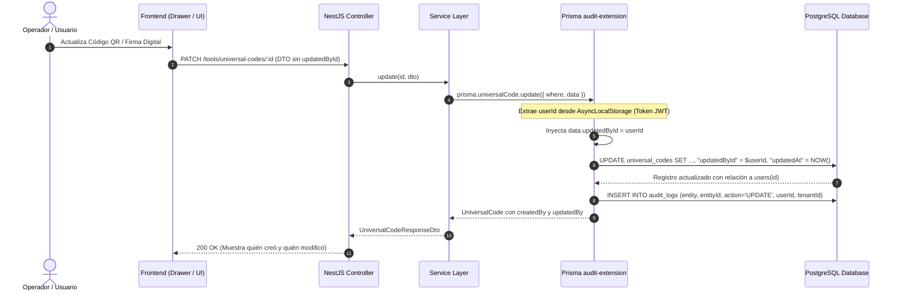

# SPEC-CORE-014: Trazabilidad Completa de Auditoría `updatedById` y Migración Canónica de Base de Datos

## 1. Estado y Metadatos
- **Código**: `SPEC-CORE-014`
- **Módulo**: Core Architecture / Auditoría y Base de Datos Transversal
- **Fecha**: 03/11/2026
- **Estado**: `COMPLETED`
- **Autor**: Antigravity Assistant & Senior Software Architect

---

## 2. Resumen Ejecutivo y Diagnóstico

### 2.1 El Problema
Al realizar operaciones de actualización (`UPDATE`) en los modelos `UniversalCode` y `SignatureRequest`, el sistema carecía de la columna y relación `updatedById` / `updatedBy`. En su momento, para evitar fallos de validación en tiempo de ejecución (`PrismaClientValidationError`), se procedió a omitir la inyección de dicho campo en `audit-extension.ts`.

Sin embargo, desde una perspectiva de gobierno, seguridad y auditoría ISO 27001 / SARLAFT, **omitir `updatedBy` en las actualizaciones no es admisible**: cuando un operador revoca un código QR, reasigna un activo o un representante aprueba/cancela una solicitud de firma digital, el sistema debe registrar fehacientemente **quién fue el autor del último cambio**, manteniendo intacto el `createdById` original.

### 2.2 Auditoría Exhaustiva de los 101 Modelos del Sistema
Se ejecutó un análisis estático sobre la totalidad de los 101 modelos declarados en `/prisma/schema/*.prisma`:

1. **Modelos con Auditoría Completa (`createdById` + `updatedById`) [66 modelos]**:
   - `CommercialSettings`, `UniversalDocumentFormat`, `Minuta`, `Client`, `Resident`, `SecurityStudy`, `PayrollEmployee`, `PayrollPeriod`, `PayrollSettlement`, etc.
2. **Modelos con Auditoría en Texto Escalar (`createdBy` + `updatedBy`) [10 modelos]**:
   - `User`, `Role`, `Department`, `Position`, `Tenant`, `ClientProperties`, `Tower`, `Floor`, `Unit`.
3. **Modelos Técnicos, Intermedios o Dependientes sin Creador Directo [23 modelos]**:
   - Tablas intermedias N:M (`UserRole`, `RolePermission`, `UserClientAccess`).
   - Líneas de detalle hijas de agregados (`ProposalServiceItem`, `ServiceOrderPosition`, `ServiceOrderEquipmentItem`).
   - Tablas de sesión y logs del sistema (`UserSession`, `AuditLog`, `FileImportLog`).
4. **Modelos Asimétricos (`createdById` SÍ, `updatedById` NO) [2 modelos]**:
   - `UniversalCode` (`prisma/schema/universal_codes.prisma`)
   - `SignatureRequest` (`prisma/schema/signature.prisma`)

**Conclusión**: `UniversalCode` y `SignatureRequest` son los únicos dos modelos del sistema que requieren la incorporación de la columna y relación `updatedById` / `updatedBy`.

---

## 3. Arquitectura y Procedimiento Canónico



---

## 4. Cambios Técnicos Específicos

### 4.1 Prisma Schema (`prisma/schema/`)

#### 1. `prisma/schema/universal_codes.prisma`
```prisma
model UniversalCode {
  id          String      @id @default(cuid())
  tenantId    String
  code        String      @db.VarChar(100)
  codeType    CodeType    @default(QR_CODE)
  purpose     CodePurpose @default(PATROL_CHECKPOINT)
  title       String      @db.VarChar(200)
  description String?     @db.Text
  department  String?     @db.VarChar(100)
  clientId    String?
  status      CodeStatus  @default(ACTIVE)
  metadata    Json?       @db.JsonB

  createdById String?
  createdBy   User?       @relation("UniversalCodeCreatedBy", fields: [createdById], references: [id], onDelete: SetNull)
  updatedById String?
  updatedBy   User?       @relation("UniversalCodeUpdatedBy", fields: [updatedById], references: [id], onDelete: SetNull)
  client      Client?     @relation(fields: [clientId], references: [id], onDelete: SetNull)
  tenant      Tenant      @relation(fields: [tenantId], references: [id], onDelete: Cascade)

  createdAt   DateTime    @default(now())
  updatedAt   DateTime    @updatedAt
  deletedAt   DateTime?

  @@unique([tenantId, code])
  @@index([tenantId, purpose])
  @@index([tenantId, clientId])
  @@index([tenantId, status])
  @@index([tenantId, createdAt])
  @@map("universal_codes")
}
```

#### 2. `prisma/schema/signature.prisma`
```prisma
model SignatureRequest {
  ...
  // Metadatos de Auditoría Interna
  createdById     String?
  createdBy       User?                 @relation("SignatureRequestsCreated", fields: [createdById], references: [id], onDelete: SetNull)
  updatedById     String?
  updatedBy       User?                 @relation("SignatureRequestsUpdated", fields: [updatedById], references: [id], onDelete: SetNull)
  createdAt       DateTime              @default(now())
  updatedAt       DateTime              @updatedAt

  @@index([tenantId])
  @@index([tenantId, status])
  @@index([token])
  @@index([documentType, documentId])
  @@map("signature_requests")
}
```

#### 3. `prisma/schema/user.prisma`
```prisma
  // Signature relations
  signatureRequestsCreated SignatureRequest[] @relation("SignatureRequestsCreated")
  signatureRequestsUpdated SignatureRequest[] @relation("SignatureRequestsUpdated")

  // Commercial relations
  universalCodesCreated   UniversalCode[]           @relation("UniversalCodeCreatedBy")
  universalCodesUpdated   UniversalCode[]           @relation("UniversalCodeUpdatedBy")
```

---

### 4.2 Archivo Oficial de Migración de Base de Datos
- **Ruta**: `prisma/schema/migrations/20261103190000_add_updated_by_to_universal_codes_and_signatures/migration.sql`
- **Contenido DDL**:
```sql
-- AlterTable universal_codes
ALTER TABLE "universal_codes" ADD COLUMN "updatedById" TEXT;

-- AlterTable signature_requests
ALTER TABLE "signature_requests" ADD COLUMN "updatedById" TEXT;

-- AddForeignKey
ALTER TABLE "universal_codes" ADD CONSTRAINT "universal_codes_updatedById_fkey" 
  FOREIGN KEY ("updatedById") REFERENCES "users"("id") ON DELETE SET NULL ON UPDATE CASCADE;

-- AddForeignKey
ALTER TABLE "signature_requests" ADD CONSTRAINT "signature_requests_updatedById_fkey" 
  FOREIGN KEY ("updatedById") REFERENCES "users"("id") ON DELETE SET NULL ON UPDATE CASCADE;
```

---

### 4.3 Extensión de Auditoría Automática (`src/common/prisma-extension/audit-extension.ts`)
- Reincorporar `'UniversalCode'` y `'SignatureRequest'` en `commercialAuditModels` o aplicar el tratamiento estándar de inyección:
  - En `operation === 'create'`: Asignar `createdById: userId` y `updatedById: userId`.
  - En `operation === 'update'`: Asignar `updatedById: userId` (sin tocar `createdById`).
  - En `operation === 'upsert'`: Asignar `createdById` en `create` y `updatedById` en `update`.

---

### 4.4 Repositorios, Servicios y DTOs

1. **`src/modules/tools/universal-codes/repositories/universal-codes.repository.ts`**:
   - Incluir `updatedBy: { select: { id: true, fullName: true, document: true } }` en `create`, `update`, `findById`, `findByCode` y `findAll`.
2. **`src/modules/tools/universal-codes/dtos/universal-code-response.dto.ts`**:
   - Exponer `updatedById` y `updatedBy` con decoradores `@ApiPropertyOptional()`.
3. **`universal-codes.service.spec.ts`**:
   - Actualizar mocks y assertions para verificar la correcta propagación de `updatedById` y `updatedBy`.

---

## 5. Plan de Ejecución y Checklist de Validación

### Fase 1: Esquemas y Migración
- [x] Actualizar `universal_codes.prisma`, `signature.prisma` y `user.prisma`.
- [x] Crear el archivo de migración SQL `20261103190000_add_updated_by_to_universal_codes_and_signatures/migration.sql`.
- [x] Solicitar confirmación y aplicar la migración a PostgreSQL (`npx.cmd prisma migrate deploy`).
- [x] Ejecutar `npx.cmd prisma generate` para sincronizar los tipos de `@prisma/client`.

### Fase 2: Backend y Extensión de Auditoría
- [x] Ajustar `src/common/prisma-extension/audit-extension.ts` para habilitar la inyección automática de `updatedById` en `UniversalCode` y `SignatureRequest`.
- [x] Actualizar `UniversalCodesRepository` para incluir `updatedBy` en las consultas.
- [x] Actualizar `UniversalCodeResponseDto` con las propiedades de Swagger.

### Fase 3: Pruebas Unitarias y Calidad
- [x] Actualizar y ejecutar `universal-codes.service.spec.ts` (cobertura $\ge 80\%$, objetivo 100%).
- [x] Ejecutar `npm.cmd run lint` (0 errores).
- [x] Ejecutar `npx.cmd tsc --noEmit` (0 errores).
- [x] Actualizar `.specs/ai-decisions.log`.

