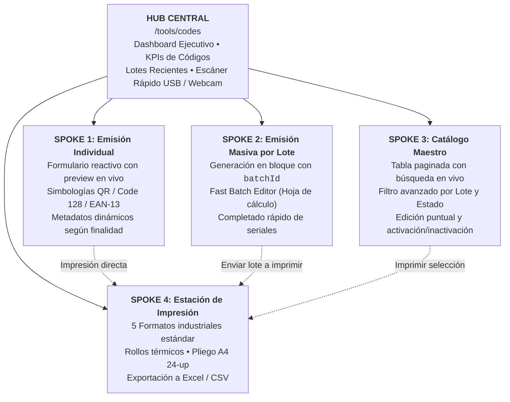

# `SPEC-CORE-015`: Reestructuración Integral del Módulo de Códigos QR y Barras (Arquitectura Hub & Spoke)

> **Estado**: `COMPLETED`  
> **Módulos Principales**: `tools/codes`, `tools/universal-codes`, `navigation`, `database`  
> **Código de Especificación**: `SPEC-CORE-015-qr-and-barcode-hub-and-spoke-module`  
> **Autor**: Senior Software Architect & Lead Systems Engineer  
> **Fecha de Creación**: 2026-11-03  
> **Ubicación Backend**:
> - `prisma/schema/universal_codes.prisma` (campo `batchId` e índice compuesto `[tenantId, batchId]`)
> - `prisma/schema/migrations/20261103200000_add_batch_id_to_universal_codes/migration.sql`
> - `src/modules/tools/universal-codes/` (servicios, repositorios, DTOs y controladores para lotes y actualización masiva)
> **Ubicación Frontend**:
> - `src/app/(protected)/tools/codes/` (página completa y componentes del Hub y Spokes)
> - `src/app/(public)/tools/codes/verify/[code]/` (página de verificación pública móvil canónica)
> - `src/components/navigation/GeneralToolsDrawer.tsx` (desmantelamiento de drawers obsoletos y redirección directa)
> - `src/config/navigationRegistry.ts` (actualización de herramientas a enlaces autónomos)
> **Aislamiento**: Multi-Tenant Estricto (`tenantId` obligatorio en base de datos y validado por guards).

---

## 1. Contexto de Negocio y Motivación

La emisión de códigos de identificación (QR, Code 128 y EAN-13) constituye una capacidad transversal neurálgica en **Loro ERP**, utilizada intensivamente para:
1. **Control Operativo**: Puntos de marcación y patrullaje de rondas de seguridad privada.
2. **Control de Inventarios y Activos Fijos**: Dotación, armamento, radios de comunicación, chalecos y cámaras de seguridad en almacén.
3. **Control de Acceso Físico**: Carnets de guardias, pases de visitantes, bicicletas y vehículos de residentes.
4. **Gestión Documental**: Radicados de correspondencia y verificación canónica de minutas.

### 1.1 Limitaciones del Esquema Anterior (Drawers)
- **Espacio Restringido e Inadecuado**: Los cajones laterales (*drawers*) limitan la visualización de datos, impiden la edición en paralelo de múltiples ítems y restringen la experiencia de usuario.
- **Inexistencia de Flujo por Lote (Batch Processing)**: Cuando el área de operaciones o almacén recibe un cargamento (por ejemplo, 20 cámaras de seguridad o 30 radios), crear 20 o 30 códigos de forma individual resulta ineficiente y propenso a errores humanos.
- **Falta de Trazabilidad de Agrupación**: No existía el concepto de "Lote", imposibilitando consultar los ítems generados en una misma tanda o relacionarlos con un cargamento específico.
- **Ausencia de Estación de Impresión Estándar**: No se disponía de soporte para pliegos de etiquetas adhesivas de oficina (tamaño carta / A4) ni para los tamaños industriales más comunes de impresoras térmicas (rollos Zebra).
- **Fricción en Formularios**: Botones deshabilitados pasivamente sin mensajes de validación explícitos al usuario.

---

## 2. Arquitectura de Diseño: Patrón Hub & Spoke

El módulo se estructura bajo el patrón de diseño **Hub & Spoke** (Centro neurálgico y radios de acción especializados), alojado en la ruta **`/tools/codes`**:



---

## 3. Especificación Detallada de Componentes

### 3.1 El Hub Central (`CodesHubDashboard.tsx`)
1. **Tarjetas de Métricas Ejecutivas**:
   - Total de códigos universales emitidos en la empresa.
   - Códigos activos vs inactivos / revocados.
   - Total de lotes de emisión registrados.
   - Desglose por simbología: QR Bidimensional vs Código de Barras Lineal (Code 128 / EAN-13).
2. **Hero Cards de Acceso Directo (Spokes)**:
   - Tarjetas interactivas de alto impacto para ingresar a cada Spoke con un solo clic.
3. **Widget de Escáner Rápido (Lector USB y Cámara Web)**:
   - Input con *autofocus* optimizado para pistolas lectoras físicas de código de barras USB y botón de activación de cámara web.
   - Consume instantáneamente `GET /tools/universal-codes/resolve/:code` para mostrar la ficha del activo/punto de marcación y permitir consultar o actualizar su estado en menos de 1 segundo.
4. **Lotes y Códigos Recientes**:
   - Tabla compacta con los últimos lotes generados, indicando fecha, finalidad, cantidad de ítems y botones directos para "Completar Seriales" o "Imprimir Rótulos".

### 3.2 Spoke 1: Emisión Individual (`SingleCodeSpoke.tsx`)
1. **Configuración de Código**:
   - Selector de Simbología: `QR_CODE`, `BARCODE_128`, `BARCODE_EAN13`.
   - Finalidad Operativa: `PATROL_CHECKPOINT`, `INVENTORY_ASSET`, `EMPLOYEE_CREDENTIAL`, `RESIDENT_VEHICLE`, `VISITOR_PASS`, `DOCUMENT_VERIFICATION`, `CORRESPONDENCE_PACKAGE`, `OTHER_CUSTOM`.
   - Campos contextuales reactivos según la finalidad (ej. número de piso, intervalo de ronda, serial de dotación, placa de vehículo, apartamento).
   - Título obligatorio con validación reactiva en tiempo real (evita botones deshabilitados sin explicación).
   - Código personalizado opcional o autogeneración canónica con prefijo institucional (`LORO-QR-...`, `LORO-BAR-...`).
2. **Previsualización Vectorial en Vivo**:
   - Renderizador SVG vectorial en tiempo real sin recargas.
   - Acciones inmediatas: "Copiar Código", "Imprimir Rótulo Individual" y "Generar Nuevo".

### 3.3 Spoke 2: Emisión Masiva y Fast Batch Editor (`BatchCodeSpoke.tsx`)
1. **Fase 1: Generación del Lote**:
   - Parámetros base: Simbología, Finalidad operativa, Departamento responsable, Cliente (opcional).
   - Cantidad de ítems a emitir ($N$: configurable entre 1 y 100).
   - Identificador de Lote (`batchId`): Autogenerado con formato intuitivo (ej. `LOTE-20261103-CAM01`) con opción de personalización.
   - Patrón de título base: ej. `"Cámara de Seguridad Almacén"` $\to$ autogenera `"Cámara de Seguridad Almacén #01"`, `"#02"`, etc.
2. **Fase 2: Fast Batch Editor (Completado en Línea tipo Hoja de Cálculo)**:
   - Inmediatamente después de emitir el lote, el usuario accede a una cuadrícula interactiva de alta velocidad.
   - Permite navegar con las teclas `Tab` o `Enter` fila por fila ingresando o escaneando con pistola el serial único de cada ítem (`serialNumber`, `brand`, etc.).
   - Botón **"Guardar Todos los Seriales"**: Persiste las modificaciones en una sola transacción atómica (`PATCH /tools/universal-codes/batch`).
   - Botón **"Enviar a Estación de Impresión"**: Transfiere automáticamente los códigos del lote a Spoke 4.
   - Botón **"Exportar a Excel / CSV"**: Descarga la relación completa del lote para auditoría.

### 3.4 Spoke 3: Catálogo Maestro y Búsqueda Paginada (`CatalogTableSpoke.tsx`)
1. **Buscador y Filtros Avanzados**:
   - Búsqueda en vivo (con debounce de 350ms) sobre código, título, departamento y seriales en metadatos.
   - Filtro por Simbología, Finalidad y Estado (`ACTIVE`, `INACTIVE`, `REVOKED`).
   - **Filtro Selector de Lote (`batchId`)**: Dropdown que lista todos los lotes emitidos para aislar inmediatamente los ítems de una tanda específica.
2. **Tabla Paginada con Acciones Contextuales**:
   - Visualización de autor y modificador (`createdBy` y `updatedBy` mediante SPEC-CORE-014).
   - Switch / botón de activación, inhabilitación y revocación con un solo clic.
   - Modal de edición puntual de metadatos (`CodeEditModal.tsx`).
3. **Selección Múltiple (Bulk Actions)**:
   - Checkboxes de selección de filas para "Imprimir Selección" o "Inhabilitar Selección".

### 3.5 Spoke 4: Estación de Impresión de Rótulos (`PrintStationSpoke.tsx`)
Centro de impresión física con 5 estándares de mercado:
1. **Rollo Térmico / Zebra Pequeña (50 mm × 25 mm / 2" × 1")**:
   - Ideal para seriales, activos fijos, dotación, herramientas y radios.
2. **Rollo Térmico / Zebra Mediana (50 mm × 50 mm / 2" × 2")**:
   - Ideal para códigos QR de rondas físicas y puntos de marcación en pared.
3. **Rollo Térmico Grande (100 mm × 50 mm / 4" × 2")**:
   - Ideal para encomiendas, cajas de correspondencia y bultos de almacén.
4. **Pliego Adhesivo A4 / Carta (24 etiquetas por hoja tipo Avery 5160)**:
   - 3 columnas × 8 filas con márgenes exactos. Permite imprimir hasta 24 rótulos en una sola hoja adhesiva en cualquier impresora láser u oficina estándar.
5. **Carnet / Escarapela PVC (85 mm × 54 mm - Formato CR80)**:
   - Formato estándar de tarjeta de identificación para carnets de guardias y pases de visitantes.

Configuración adicional:
- Switch para incluir/ocultar el logotipo corporativo Loro ERP / Tenant.
- Vista previa en pantalla (WYSIWYG) con disparador directo del cuadro de impresión del navegador (`@media print` milimétrico).

### 3.6 Página Canónica de Verificación Pública Móvil
- Ruta pública: `src/app/(public)/tools/codes/verify/[code]/page.tsx`
- Al ser escaneado con la cámara de cualquier celular sin autenticación previa, muestra una ficha institucional limpia certificando la autenticidad del punto de control, activo o credencial ante supervisores o residentes.

---

## 4. Cambios en Base de Datos y Persistencia

### 4.1 Modificación de Esquema (`prisma/schema/universal_codes.prisma`)
```prisma
model UniversalCode {
  id          String      @id @default(cuid())
  tenantId    String
  code        String      @db.VarChar(100)
  codeType    CodeType    @default(QR_CODE)
  purpose     CodePurpose @default(PATROL_CHECKPOINT)
  title       String      @db.VarChar(200)
  description String?     @db.Text
  department  String?     @db.VarChar(100)
  clientId    String?
  batchId     String?     @db.VarChar(100)
  status      CodeStatus  @default(ACTIVE)
  metadata    Json?       @db.JsonB

  createdById String?
  createdBy   User?       @relation("UniversalCodeCreatedBy", fields: [createdById], references: [id], onDelete: SetNull)
  updatedById String?
  updatedBy   User?       @relation("UniversalCodeUpdatedBy", fields: [updatedById], references: [id], onDelete: SetNull)
  client      Client?     @relation(fields: [clientId], references: [id], onDelete: SetNull)
  tenant      Tenant      @relation(fields: [tenantId], references: [id], onDelete: Cascade)

  createdAt   DateTime    @default(now())
  updatedAt   DateTime    @updatedAt
  deletedAt   DateTime?

  @@unique([tenantId, code])
  @@index([tenantId, purpose])
  @@index([tenantId, clientId])
  @@index([tenantId, batchId])
  @@index([tenantId, status])
  @@index([tenantId, createdAt])
  @@map("universal_codes")
}
```

### 4.2 Migración SQL Canónica
`prisma/schema/migrations/20261103200000_add_batch_id_to_universal_codes/migration.sql`:
```sql
-- AlterTable universal_codes
ALTER TABLE "universal_codes" ADD COLUMN "batchId" VARCHAR(100);

-- CreateIndex
CREATE INDEX "universal_codes_tenantId_batchId_idx" ON "universal_codes"("tenantId", "batchId");
```

---

## 5. Cambios en Backend (NestJS)

### 5.1 DTOs (`src/modules/tools/universal-codes/dtos/universal-code.dto.ts`)
- `CreateBatchUniversalCodesDto`:
  - `codeType`: Enum `CodeType`
  - `purpose`: Enum `CodePurpose`
  - `quantity`: Entero validado `@Min(1)` y `@Max(100)`
  - `titlePattern`: Cadena descriptiva base (ej. "Cámara de Seguridad Almacén")
  - `batchId`: Cadena opcional (si se omite, se genera automáticamente)
  - `department`: Cadena opcional
  - `clientId`: Cadena opcional
  - `baseMetadata`: Objeto JSON opcional
- `BatchUpdateItemDto`:
  - `id`: Cadena obligatoria
  - `title`: Cadena opcional
  - `department`: Cadena opcional
  - `status`: Enum `CodeStatus` opcional
  - `metadata`: Objeto JSON opcional
- `BatchUpdateUniversalCodesDto`:
  - `items`: Arreglo validado de `BatchUpdateItemDto`
- Incorporación de `batchId?: string` en `QueryUniversalCodesDto` y `UniversalCodeResponseDto`.

### 5.2 Repositorio (`UniversalCodesRepository`)
- Incorporación de filtro por `params.batchId` en `buildWhere`.
- `createBatch(items: Prisma.UniversalCodeUncheckedCreateInput[])`: Inserción masiva o transaccional.
- `batchUpdate(tenantId: string, items: Array<{ id: string; data: Prisma.UniversalCodeUncheckedUpdateInput }>)`: Actualización atómica en transacción `$transaction`.
- `findBatches(tenantId: string)`: Agrupación y conteo de lotes emitidos.

### 5.3 Servicio (`UniversalCodesService`)
- `createBatch(dto, user)`: Generación de $N$ códigos canónicos con `batchId` compartido.
- `batchUpdate(dto, user)`: Guardado masivo de seriales y atributos únicos.
- `listBatches(user)`: Obtención del catálogo de lotes para filtros.
- Cobertura de pruebas unitarias actualizada con Jest $\ge 80\%$.

### 5.4 Controlador (`UniversalCodesController`)
- `POST /tools/universal-codes/batch`
- `PATCH /tools/universal-codes/batch`
- `GET /tools/universal-codes/batches`

---

## 6. Cambios en Frontend (Next.js)

### 6.1 Erradicación de Drawers
- Eliminación del archivo `src/components/tools/UniversalCodesDrawer.tsx`.
- Actualización de `GeneralToolsDrawer.tsx`: Enrutamiento directo a `/tools/codes?type=BARCODE_128` y `/tools/codes?type=QR_CODE`.
- Actualización de `navigationRegistry.ts`: Configuración como enlaces directos (`actionType: "LINK"`).

### 6.2 Nueva Página y Componentes Spoke (`src/app/(protected)/tools/codes/`)
- `page.tsx`: Orquestador de la vista Hub & Spoke con sincronización de estado en URL (`?spoke=...`).
- `components/CodesHubDashboard.tsx`: Tablero de control, métricas, accesos rápidos y escáner.
- `components/SingleCodeSpoke.tsx`: Emisión individual con previsualización SVG/QR reactiva.
- `components/BatchCodeSpoke.tsx`: Generador de lotes y Fast Batch Editor en cuadrícula.
- `components/CatalogTableSpoke.tsx`: Catálogo maestro con búsqueda, filtro por lote y acciones.
- `components/PrintStationSpoke.tsx`: Estudio de impresión con los 5 estándares industriales.
- `components/CodeEditModal.tsx`: Diálogo modal de edición individual.
- `components/QuickScannerDialog.tsx`: Modal para pistola lectora USB y cámara web.

---

## 7. Plan de Ejecución y Checklist

### Fase 1: Base de Datos y Backend
- [x] Modificar `prisma/schema/universal_codes.prisma` agregando `batchId` e índice.
- [x] Crear archivo de migración SQL `20261103200000_add_batch_id_to_universal_codes/migration.sql`.
- [x] Solicitar confirmación y aplicar migración en base de datos (`npx.cmd prisma migrate deploy`).
- [x] Ejecutar `npx.cmd prisma generate --no-engine` para actualizar tipos.
- [x] Actualizar DTOs con `CreateBatchUniversalCodesDto`, `BatchUpdateUniversalCodesDto` y `batchId`.
- [x] Implementar métodos de lote en `UniversalCodesRepository`.
- [x] Implementar lógica de negocio en `UniversalCodesService`.
- [x] Exponer endpoints en `UniversalCodesController`.
- [x] Crear pruebas unitarias con cobertura $\ge 80\%$ en `universal-codes.service.spec.ts` y `repository.spec.ts`.
- [x] Validar Backend: `tsc --noEmit` (0 errores) y `npm run lint` (0 errores).

### Fase 2: Desmantelamiento de Drawers y Cliente API
- [x] Actualizar `src/lib/api/universal-codes.ts` con soporte de lotes y `batchId`.
- [x] Eliminar `src/components/tools/UniversalCodesDrawer.tsx`.
- [x] Actualizar `GeneralToolsDrawer.tsx` y `navigationRegistry.ts`.

### Fase 3: Página Hub & Spoke en Frontend
- [x] Crear página principal `/tools/codes/page.tsx`.
- [x] Desarrollar componente `CodesHubDashboard.tsx` con KPIs y accesos directos.
- [x] Desarrollar `SingleCodeSpoke.tsx` con formulario validado y preview en vivo.
- [x] Desarrollar `BatchCodeSpoke.tsx` con generador masivo y Fast Batch Editor.
- [x] Desarrollar `CatalogTableSpoke.tsx` con búsqueda paginada y filtro por lote.
- [x] Desarrollar `PrintStationSpoke.tsx` con los 5 formatos de etiqueta y estilos `@media print`.
- [x] Desarrollar `CodeEditModal.tsx` y `QuickScannerDialog.tsx`.
- [x] Desarrollar página pública de verificación móvil `/verify/code/[code]/page.tsx`.
- [x] Validar Frontend: `tsc --noEmit` (0 errores) y `npm run lint` (0 errores).

### Fase 4: Cierre, Memoria y Documentación
- [x] Marcar checklist completado en `SPEC-CORE-015`.
- [x] Actualizar `.specs/ai-decisions.log` con la decisión arquitectónica.

